# GT7 Tutor user guide

This guide shows how to use GT7 Tutor, from the first start to the review of your attempts and your races.
To install and start GT7 Tutor, read the [README](../../README.md#quick-setup-macos-and-linux) first.

The pictures show recorded data. The exercise is the Circuit Experience of Autódromo de Interlagos, sector 2. The two races have 5 and 7 laps. With your PS5, the same screens show your own data. `Sam` and `demo` are test profile names.

## Contents

1. [Words in this guide](#words-in-this-guide)
2. [What you need](#what-you-need)
3. [Create the first profile](#create-the-first-profile)
4. [Get ready: console, voice and first exercise](#get-ready-console-voice-and-first-exercise)
5. [Find your way in the application](#find-your-way-in-the-application)
6. [Choose an exercise](#choose-an-exercise)
7. [Record the reference](#record-the-reference)
8. [Set up the cues](#set-up-the-cues)
9. [Drive an attempt](#drive-an-attempt)
10. [Review an attempt](#review-an-attempt)
11. [See all attempts and recurring differences](#see-all-attempts-and-recurring-differences)
12. [Track your progress](#track-your-progress)
13. [Record a race and look at it](#record-a-race-and-look-at-it)
14. [Manage references](#manage-references)
15. [Profiles: sign in, sign out, switch, change and delete](#profiles-sign-in-sign-out-switch-change-and-delete)
16. [Other settings](#other-settings)
17. [Delete data](#delete-data)
18. [Use a phone](#use-a-phone)
19. [Try the demo](#try-the-demo)
20. [Common problems](#common-problems)

## Words in this guide

| Word | Meaning |
| --- | --- |
| Telemetry | The data that GT7 sends from the PS5 about 60 times per second: position, speed, pedals and the time of the run. GT7 Tutor reads only this data. It does not see the game picture. |
| Exercise | One task of the game that you want to practise, for example a licence test or a Circuit Experience sector. |
| Demonstration | The drive that the game shows before an exercise. |
| Reference | The recorded part of the demonstration that GT7 Tutor compares your drive with. The voice cues come from it. |
| Attempt | One run of the exercise that you drive. GT7 Tutor finds its start and finish by itself. |
| Cue | A short voice instruction at one place of the section, for example `Hard brake. One fifteen`. The Drive screen shows the same words. |
| Voice device | The one browser that plays the cues for your profile: the computer or a phone. |
| Difference | A place where your attempt is not the same as the reference, for example `Braked 17 m earlier`. The reference is one recorded drive, not the best possible line. |
| Recurring difference | A difference at the same place in at least half of your last complete attempts. |
| Capture | The raw file of all telemetry that GT7 Tutor received during a recording, an attempt or a race. |
| Race | A race by laps in the game that GT7 Tutor recorded. |
| Lap | One lap of a race, from one lap line to the next. A lap keeps the number that the game gives it. |
| Best lap | The lap of the race with the shortest lap time. A lap with a pit stop does not count, unless each lap has a pit stop. |
| Pit stop | A stop in the pit lane between two laps. The lap before the stop is the in-lap. The lap after it is the out-lap. |
| Off the track | A moment with two or more wheels on a surface that is not the track or a kerb, for example grass or gravel. |
| Recurring place | A place of the track where you went off the track in 3 or more laps of one race. |
| Clean lap | A lap of a race that is not lap 1 and has no pit stop. When the recording starts after lap 1, the first recorded lap is not clean either. |
| Golden lap | The fastest lap that you can drive from parts of the clean laps of one race. |

## What you need

- A computer with macOS or Linux on your home network that runs GT7 Tutor. The [README](../../README.md#what-you-need) tells you how to install and start it.
- A PS5 with Gran Turismo 7 on the same network.
- A browser on that computer, or on a phone on the same network.

To try GT7 Tutor without a PS5, see [Try the demo](#try-the-demo).

## Create the first profile

**When:** the first time that you open GT7 Tutor on this computer.

1. Open the address that `./start.sh` shows, for example `http://localhost:3000`.
2. On **Create the first profile**, type a **Name**.
3. Type a **Password** of at least 8 characters.
4. Select **Create profile**.

**Result:** GT7 Tutor signs you in and shows **Get ready to train**.

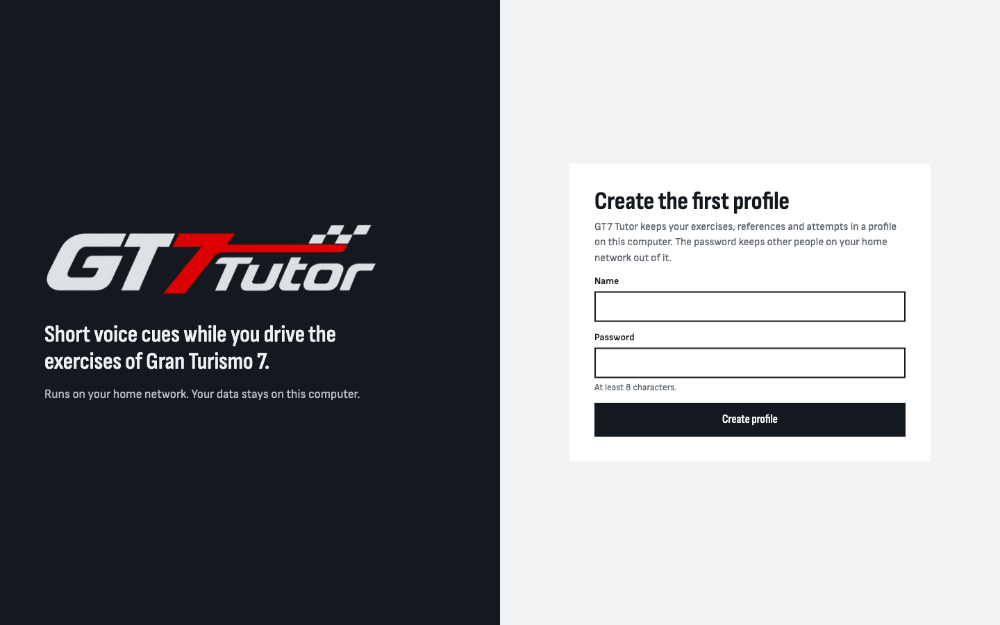

A profile keeps your exercises, references, attempts and races. The password stops other people on your home network from opening your profile.
GT7 Tutor uses plain HTTP. Do not make it reachable from the internet.

## Get ready: console, voice and first exercise

**When:** after the first sign-in. The Exercises page shows **Get ready to train** until you save a console address.

**Get ready to train** has three steps. The bar shows how many steps are ready.

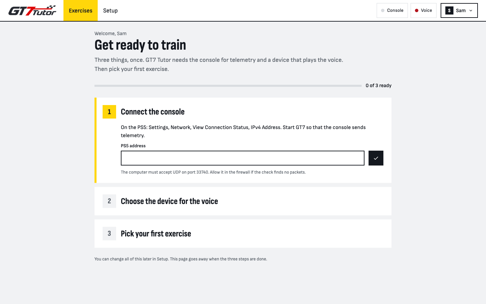

### Step 1: connect the console

1. On the PS5, open **Settings** → **Network** → **View Connection Status**. Read the **IPv4 Address**, for example `192.168.0.20`.
2. Start Gran Turismo 7 and go past the title screen. The console sends telemetry only when GT7 runs.
3. In GT7 Tutor, type the address in **PS5 address**.
4. Select the check button (**Save and check**).

**Result:** the step shows one of these:

- `Receiving telemetry`: the connection works.
- `Address saved, no telemetry yet`: GT7 Tutor received no packets. See [No packets from the console](#no-packets-from-the-console).

All profiles on this computer use the same address.

### Step 2: choose the device for the voice

1. Open GT7 Tutor on the device that must play the cues: this computer, or a phone.
2. Select **Use this device for voice**.

**Result:** the step shows `This device`. Select the speaker button to hear `Voice check`.

To decide later, select **Set up the voice later**. You can choose the device in **Setup** → **Voice** at any time.

### Step 3: pick your first exercise

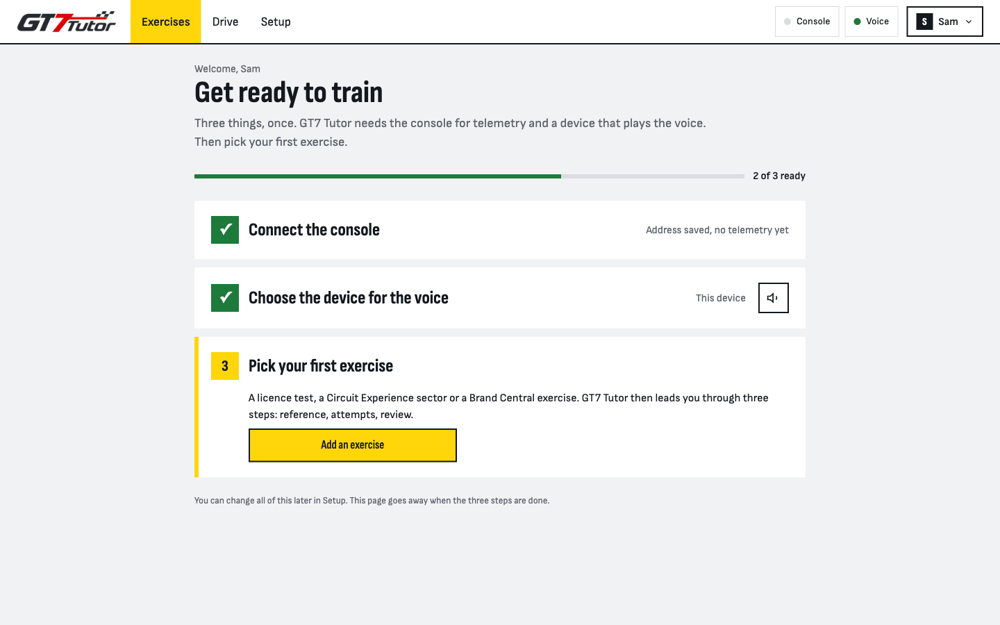

Select **Choose an exercise**. The Exercises page opens. See [Choose an exercise](#choose-an-exercise).

## Find your way in the application

The menu has three items. On a computer, they are in the top bar. On a phone, they are in the bottom bar.

- **Exercises**: your exercises, the catalogue and each exercise.
- **Races**: the races that you recorded, and **Record a race**.
- **Setup**: console, voice, profiles, preferences, catalogue and data.

The yellow **Drive** button starts an attempt. It is on the **Continue** card, on the **Attempts** tab and on the review of an attempt.

The top bar also has:

- **Console** and **Voice**, each with a dot. Select one of them to open its Setup section.
- Your profile button. It opens a menu with **Manage profiles**, **Voice on this device**, **Theme** and **Sign out**.

| Dot | Green | Yellow | Red | Grey |
| --- | --- | --- | --- | --- |
| **Console** | `Receiving telemetry` | `Waiting for packets` | `No packets. Check the console address.` or `GT7 Tutor does not answer. Check that it runs on the computer.` | `No telemetry now. It starts with a recording, a training or a check.` |
| **Voice** | `This device plays the voice` or `Another device plays the voice` | `The sound did not start on this device` | `No device plays the voice` | |

### The page of an exercise

The header has the breadcrumb `Exercises / <exercise title>`, the title, and one line with the family, the name and the track. A licence test shows the licence and the code as its title, for example `National B, B-5`.

Under the header, a band shows these times:

- `your best`: your best time.
- `target`: the time that you want to reach, with **edit**. See [Set the target](#set-the-target).
- `gap to the target`: your best time minus the target.
- `reference` and `gap to the reference`: the time of the active reference, and your best time minus it.

When the exercise has no value yet, the band shows `–`.

When the exercise has a reference or an attempt, the page has three tabs:

| Tab | Content |
| --- | --- |
| **Cues** | What the voice says, and where. The exercise opens on this tab. |
| **References** | The history of the references of the exercise |
| **Attempts** | The **Drive** button, all attempts by day, and the recurring differences |

The review of an attempt keeps the header and the tabs of its exercise.

## Choose an exercise

**Goal:** find an exercise of the game and record its first reference.

The Exercises page shows your exercises and the whole catalogue. A catalogue entry becomes your exercise when you record its first reference.

1. Select **Exercises**.
2. Find the exercise. Use one or more of these:
   - Type in the search field: a name, code, track or car, for example `B-3` or `Interlagos`.
   - Select a family: **All**, **Licence**, **Circuit Experience**, **Brand Central** or **Own**.
   - Select a track in **All tracks**.
3. Under **Catalogue**, select the group of the exercise to open it, for example `National B`. A search or a track opens all groups that have a match.
4. Select **Record the reference** in the row of the exercise. On a phone, select the row first. The row opens and shows the button.

**Result:** GT7 Tutor creates the exercise and opens **Record the reference**.

The filters apply to **In progress** and to the catalogue. `No exercise matches.`: check the spelling, or select **Clear filters**.

The catalogue has one group for each licence, each Circuit Experience track and each Brand Central brand. The line of a group gives the number of entries, then the number of your exercises at the target and in progress, for example `10 tests · 6 at target · 2 in progress`.

The right part of a row gives the state:

- No reference yet: the target, for example `target 0:20.800`, and **Record the reference**.
- An exercise with a best time: the best time and the gap, for example `0.07 s to the target`, or the tag `Target reached`.
- The current exercise has a yellow bar at the left.

Select the row of one of your exercises to open it.

A licence test has a target from the catalogue: the gold time of the test. The other exercises have no target until you set one.

A catalogue entry does not mean that GT7 Tutor can follow the exercise. GT7 Tutor needs two things from the game: the game times the demonstration, and the game times your run from the start.

### Create your own exercise

Use this for an exercise that the catalogue does not list, for example a Time Trial on one layout.

1. At the end of the catalogue, under **Own**, select **Your own exercise**.
2. Type the **Activity**. The default is `Time Trial`.
3. Type a **Name**.
4. Select the check button (**Create exercise**).

**Result:** the page of the new exercise opens with the button **Record the reference**. If the game does not time a demonstration of the activity, you cannot record a reference for it.

## Record the reference

**Goal:** give GT7 Tutor the drive that it compares your attempts with.
**Before you start:** you saved the console address, GT7 runs, and no other recording runs.

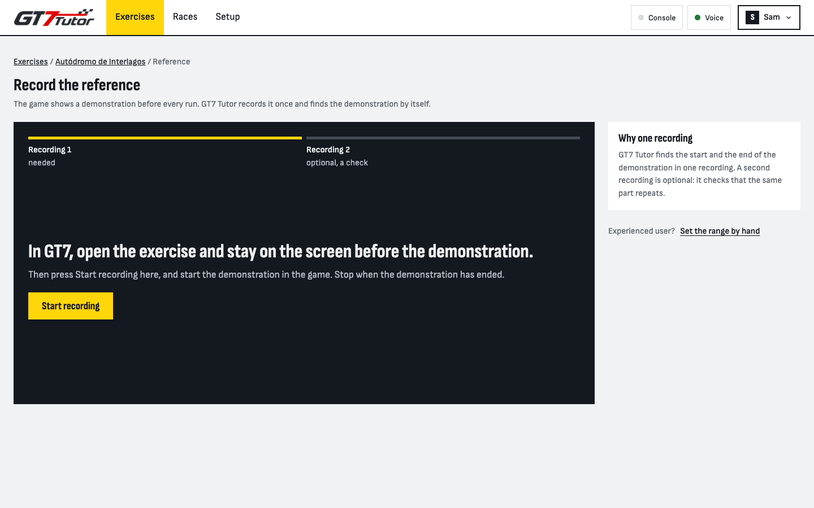

1. On the exercise page, select **Record the reference**.
2. In GT7, open the exercise. Stay on the screen before the demonstration.
3. In GT7 Tutor, select **Start recording**.
4. In GT7, start the demonstration and let it play to the end.
5. In GT7 Tutor, select **Stop recording 1**.

**Result:** GT7 Tutor finds the demonstration by itself. It shows **The demonstration is found** with its time and its frames.

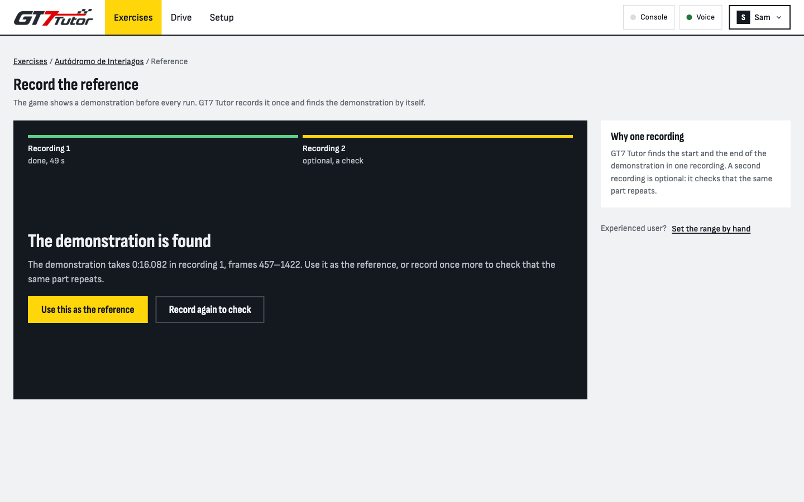

6. Select **Use this as the reference**.

**Result:** `The reference is active`. Select **Drive** to start an attempt, or **Hear the cues** to see what the voice says.

Other choices on this screen:

- **Record again to check** makes a second recording. GT7 Tutor then tells you if the same part repeats in both recordings. The check is optional.
- **Select the demonstration**: when a recording holds more than one demonstration, select one.
- **Cancel this recording** stops the recording and does not use it.
- **Set the range by hand**: select a finished recording, then type the **First frame** and **Last frame** of the demonstration.

A recording needs the training off. When the training is on, the button says **Stop the training and record**. While an attempt runs, you cannot start a recording.

**Possible problems:**

- `No complete demonstration found`: select **Record again** and let the demonstration play to the end.
- `Enter the PS5 address in Setup first.`: save the console address in **Setup** → **Console**.
- `Another recording or training runs. Stop it first.`: another recording runs, or another profile trains. Select **Stop recording** in the yellow bar at the top.
- `This range does not hold the whole demonstration.`: type frames from before the start to after the end of the demonstration.

## Set up the cues

**Goal:** choose what the voice says, and when.
**Where:** the **Cues** tab of the exercise.

The list shows each cue and each turn in the order of the section. Each cue row has:

- The distance from the start of the section and the phrase, for example `291 m`, `Hard brake. One fifteen`.
- The target speed in km/h. For a brake, it is the lowest speed of the reference there, with `lowest speed`. For a throttle cue, it is the speed of the reference 2 s later. `–` means that the cue has no target speed.
- **Hear** (play icon): plays the phrase on this device.
- **Mute** (speaker icon) and **Unmute**: the voice does not say a muted cue, and the Drive screen does not show it. A muted cue has its phrase struck through.
- **Timing**: select the phrase to open the row. The **Timing** slider moves this cue up to 1 s earlier or 0.5 s later. A closed row with a moved timing shows it, for example `0.5 s earlier`.
- Notes from your attempts, for example `Braked early in 2 of 3 attempts, median 26 m`. A yellow row marks a place where a difference repeats.
- The tag `NOT SPOKEN`: the voice says one cue at a time, so this cue comes too soon after another cue. The line under the phrase tells you what to do, for example `The voice still says cue 3 here. Mute cue 3 or this cue, or move cue 3 earlier.`

The turn rows (`T1`) show the turn-in, the apex, the radius and the speed of the reference at the apex. The voice does not say them. A turn with a brake zone also shows how the reference brakes, for example `Brake to 377 m, 87 % at the turn-in. Lowest speed at the apex.`

Settings above the list (on a phone, under the map):

- **Speak target speeds**: on, the voice says the lowest speed of the reference after a brake phrase. Off, it says the action only.
- **Side cue distance**: `Off`, or 0.5 m to 3 m. The voice says `More left` or `More right` when the car stays farther than this distance from the reference line.

The map `Reference line, <length> m` shows the cue numbers. Yellow bands mark the turns. A short bar and an arrow mark the start and the direction of travel. A chequered bar marks the finish. Select a cue number to mute or unmute that cue. **View** opens the map in full screen with the list of the cues. Press Esc or select **Back** to close it.

### Preview the cues

**Preview** (play icon, next to **View**) plays the cues on this device in the time of the reference, with the settings of this tab.

1. Select **Preview**. A yellow dot moves along the reference line.
2. Listen to the cues. The row of the cue that the voice says shows the tag `SPEAKING`. Under the map, the time shows the progress, for example `0:11.3 of 0:16.1, measured`.
3. To stop before the end, select **Stop** (square icon).

The preview stops at the end of the reference, when you change a setting, and when you leave the tab. It does not record an attempt.

Changes apply from the next **Drive**.

## Drive an attempt

**Goal:** drive the exercise with the cues on the screen and, if you want, on the voice device.
**Before you start:** the exercise has an active reference, and the console sends telemetry.

### Start

1. Select **Drive** on the **Continue** card, on the **Attempts** tab, or on the review of an attempt.
2. In GT7, start the exercise and drive. You do not need to touch GT7 Tutor.

**Result:** the dark Drive screen opens and shows `READY`. GT7 Tutor finds the start and the finish of the attempt by itself. The time of the attempt is the time from the game.

The READY screen gives the first cue after the start. When this device must speak and no device plays the voice, select **Use this device for voice** on this screen.

Other states of the **Drive** button:

- Without an active reference, the **Attempts** tab shows `Record the reference first.` with the link **Record**.
- When the training of another exercise is on, a dialog asks `The training of <exercise> is on. Stop it and start this exercise?`. Select **Stop and start** or **Cancel**.
- While an attempt of another exercise runs, nothing starts. The text under the button tells you to finish it or stop the training first.

### During the attempt

| Part | Meaning |
| --- | --- |
| **Telemetry**, **Voice** | The status dots. Green means ready. The line under them gives the exercise name and `Attempt <n>`. |
| Large yellow words | The current cue, for example `HARD BRAKE 115`. It shows for about 3 s. |
| `Next: …, in … m` | The next cue and the distance to it |
| `Cue 2 of 6 · before T1` | The number of the current cue and the next turn |
| km/h | Your speed |
| `m of 818` | Your distance on the reference |
| `s to reference` | Your time at this place minus the time of the reference at the same place. A positive value means that you are slower. |
| Map | Your position on the reference line |

The voice speaks about half a second before the place where the reference does the action. The cues are:

- `Hard brake`, `Brake` or `Light brake`: the reference loses at least 40 %, at least 15 % or less than 15 % of its speed.
- `Lift off`: the reference takes the foot off the throttle and does not brake.
- `Throttle on` or `Full throttle`: the reference opens the throttle. The cue is `Full throttle` when the reference reaches full throttle within 2 s.
- `Big brake ahead` before a long, hard brake.
- `Closer to apex` when you run wide before an apex.
- `More left` or `More right`, if **Side cue distance** is on.
- `Guidance paused` and `Guidance resumed` when GT7 Tutor cannot follow your position.

When you pause the game, the screen shows `Paused. Cues stop until you continue.` The attempt continues after the pause.

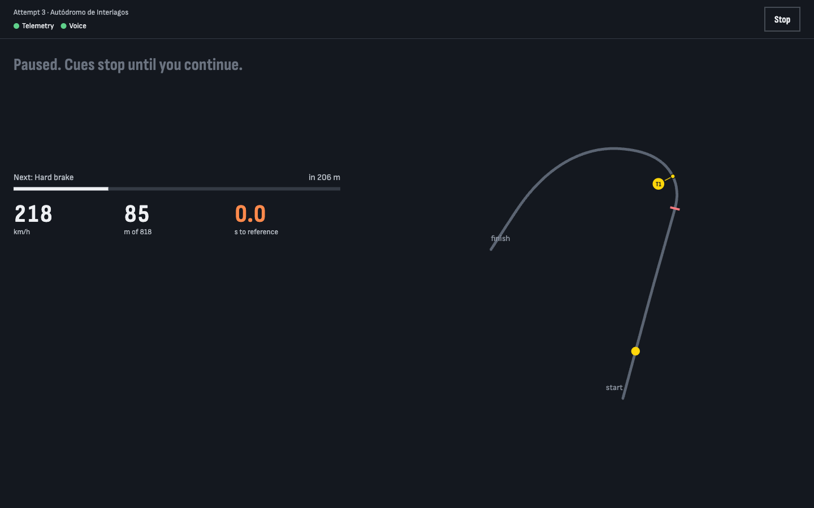

### After the finish

The summary shows:

- The time from the game.
- **Most time lost in this attempt**: the turn where this attempt lost the most time. The sentence also gives the part of the turn and the cause, for example `Turn one. Too slow on entry.` The voice device also says it.
- **Gap to your best**.

The sentence of **Most time lost in this attempt** names one of three parts of the turn:

| Part | Where | Sentences |
| --- | --- | --- |
| Before the turn | To the turn-in of the reference | `Braking too early before the turn.`, `Braking too late before the turn.` |
| Entry | From the turn-in to the apex | `Too slow on entry.`, `Too fast on entry.`, `Far from the apex on entry.` |
| Exit | From the apex to the next turn | `Late on the throttle on exit.` |

Other sentences:

- A late brake gives `Braking too late before the turn.` in each part.
- When you were off the line in the part, and the part has no other difference, the sentence says `Off the line`, for example `Off the line on entry.`
- When the part has no difference, the sentence names only the part, for example `Turn two. Time lost on exit.`

The box is not on the screen when no turn lost 0.1 s or more, for example in a licence test on a straight. Above turn 10, the screen shows the sentence, for example `Turn 11. Time lost on exit.`, and the voice does not say it.

Then:

- **Review this attempt** opens the review.
- **Drive again** closes the summary. The training stays on. Restart the exercise in GT7 to drive the next attempt.
- **Stop training** at the top right ends the training.

An attempt that does not finish shows `No time` and the reason, for example `left the track`, `restarted` or `training stopped`.

### Drive with or without the voice

You decide which help you use:

- **With the voice:** select a voice device. The voice says the cues.
- **Without the voice:** select **Turn voice off here** in **Setup** → **Voice**, or do not select a voice device. The screen still shows the cues.
- **Without some cues:** mute them on the **Cues** tab.

GT7 Tutor compares every attempt with the reference from the game demonstration.

### Stop

Select **Stop training** at the top right. If an attempt runs, it stops with the reason `training stopped` and has no time. The **Attempts** tab of the exercise opens.

While the training is on, the other screens show a yellow bar under the top bar, for example `The training is on: <exercise>. Restart the exercise in GT7 to drive the next attempt.` **Open Drive** opens the Drive screen. **Stop training** ends the training. Stop the training when you do not drive.

### Possible problems

- `The attempt did not start`: the exercise was already running when you selected **Drive**. Restart the exercise in GT7, then select **OK**.
- `No packets from the console. Check that GT7 is running and that the address in Setup is right.`: see [No packets from the console](#no-packets-from-the-console).
- `Connection to GT7 Tutor lost.`: check that GT7 Tutor runs and that the device is on the home network.
- `Record and confirm a reference first.`: select **Record the reference**.
- `The recording is incomplete`: GT7 Tutor could not write the whole capture to the disk. The cues continue. Check the free disk space.

## Review an attempt

**Goal:** see where and how your attempt is different from the reference.
**Where:** **Review this attempt** after the finish, or a row on the **Attempts** tab.

The title gives the attempt number and the time, for example `Attempt 2 · 0:18.824`. The line under the title gives the gap to your best attempt and the gap to the reference. The yellow **Drive** button starts the next attempt.

| Part | What it shows |
| --- | --- |
| **Your line** | The map with the reference line (blue) and your line (orange). A circle marks a difference. A gap in your line is a place where GT7 Tutor could not match your position. |
| **True scale** / **Side distance × 6** | **Side distance × 6** draws your line 6 times farther from the reference line, so that a difference of 1 m shows. A dot marks the largest side distance in each turn. Point to a dot, or touch it, to see the true distance, for example `T1 · 3.5 m left`. |
| **View** | Opens the map in full screen with the list of the differences. Press Esc or select **Back** to close it. |
| **Differences by turn** | The differences, grouped by turn, with the time lost or gained in each turn. The headers **Turn** and **Time lost** set the order. Select a difference to put the cursor there. `No differences above the limits in this attempt.` means that GT7 Tutor found no difference. |
| **Corners** | Your line at each apex: on the line, or the distance inside or outside, and your speed at the apex |
| **Brake reaction** | The time from the start of a spoken brake cue to your brake. `before the cue` means that you braked before the voice. |
| Charts | Speed, throttle, brake, the distance from the reference line, and the time lost. On **Speed**, a ring marks the lowest speed of each line in each turn with a brake zone. |
| **Compare with** | Another reference of the exercise. The review then compares the same attempt with that reference. `used` marks the reference that you drove this attempt against. |

**Use the charts:** move the pointer across a chart. On a phone, touch a chart or move a finger sideways on it. A vertical swipe scrolls the page. With a keyboard, move the focus to a chart and use the arrow keys. All charts and the map show the cursor. A box gives the distance, the turn and the values, for example `Reference: 110 km/h` and `You: 108 km/h`. The charts of a race work in the same way.

Read a difference with care. `Braked 37 m later` compares the brake of the reference with your nearest brake within 60 m. If you pressed the brake two times, the charts show both.
`Lowest speed 53 m before the apex` tells you that your lowest speed in the turn is more than 20 m before the lowest speed of the reference.

Other actions under **Source**:

- **Use this attempt as a reference** (complete attempts only): the attempt becomes the active reference. The demonstration stays in the reference history.
- **Delete attempt**: opens a dialog that shows what goes. See [Delete data](#delete-data).

## See all attempts and recurring differences

**Where:** the **Attempts** tab of the exercise.

- `Your focus` above **Drive** gives the sentence of **Most time lost in this attempt** from your last complete attempt with the active reference.
- The attempts are in groups by day. **Time** is the time of a complete attempt from the game. The best attempt has the tag `best`. An attempt that did not finish shows `No time` and the reason.
- **Gap to best**: the gap of the attempt to your best time.
- Select a row to open the review of the attempt.
- **Hide aborted** hides the attempts that did not finish. Select **Show aborted** to show them again.
- **Select**: mark attempts, then delete them. The quick buttons of each day mark the aborted attempts or all attempts of the day. See [Delete data](#delete-data).

**Recurring differences** lists the differences at the same place in at least half of your last 8 complete attempts with the active reference. You need at least 3 complete attempts. `No difference repeats in your last attempts.` means that no difference reaches half of them.

## Track your progress

The **Exercises** page shows:

- **Continue**: the current exercise, `your best time` and the gap to the target, for example `0.67 s` with `to the target, 0:16.400`. `Your focus` gives the same sentence as on the **Attempts** tab. The main button is **Drive**, or **Record the reference** when the exercise has no active reference. Select the exercise title to open the exercise.
- **In progress**: your exercises that are not at the target. Each row gives the title, the best time and the gap to the target.
- **Catalogue**: all entries in groups. See [Choose an exercise](#choose-an-exercise).

The current exercise is the exercise of the training that runs. Without a training, it is usually the exercise of your last attempt or the exercise that you opened last.

An exercise gets the tag `Target reached` when your best time is equal to the target or less. An exercise at the target is not in **In progress**.

### Set the target

1. Open the exercise. In the band, select **edit** next to `target`.
2. Type the time, for example `23.8`, `0:23.800` or `1:02.345`. On a phone keypad without `:`, type the seconds only, for example `62.345`.
3. Press **Enter**, or select another place on the page.

**Result:** the band shows the new target and the `gap to the target`.

- **Esc** keeps the old target.
- An empty field deletes the target.

## Record a race and look at it

GT7 Tutor can record a race by laps in the game. After the race, you can examine your laps, compare two laps, and find the places where you went off the track. A race needs no reference. A race gives no voice cues.

### Record a race

**Before you start:** you saved the console address, GT7 runs, and no recording or training runs.

1. Select **Races** in the menu.
2. Select **Record a race** (on a phone: **Record**).
3. In GT7, start a race of 2 or more laps.

**Result:** the dark recording screen opens. The recording starts and stops with the race. You do not need to touch GT7 Tutor during the race.

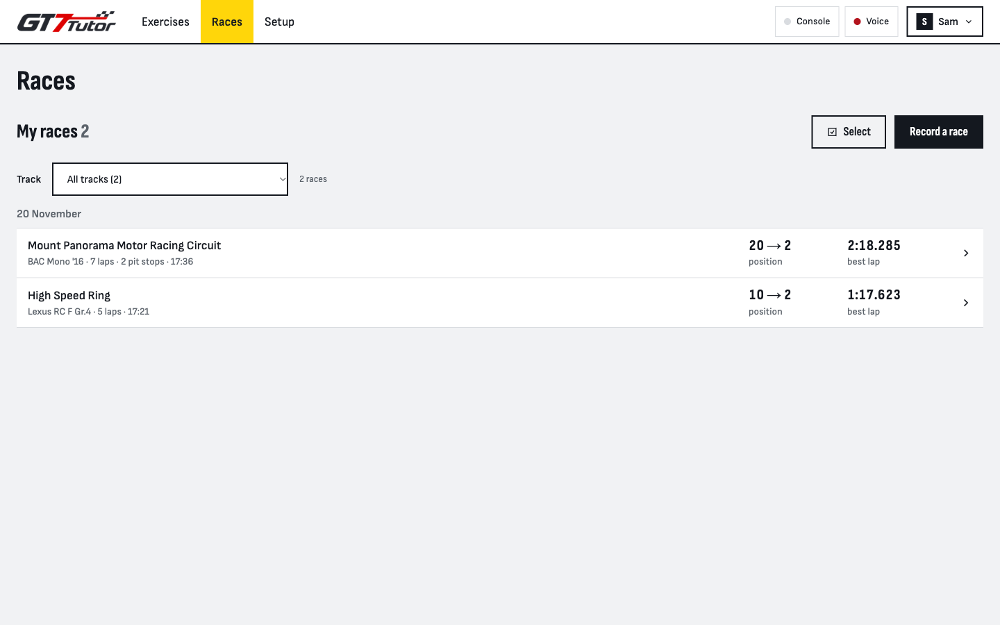

| State | Large word | What the screen shows |
| --- | --- | --- |
| Waiting | `WAITING` | `Start a race of 2 or more laps in the game.` |
| A lap runs | `LAP <n> of <n>` | `this lap`, the position, `last lap`, `best lap · lap <n>`, and the fuel with `about <n> laps left` |
| Finished | `FINISHED` and your finish position | The `race time` and the `best lap` |
| Stopped | `RECORDING STOPPED` | The number of laps in your list, the best lap and the position |

The lap circles show one circle for each lap. A key under the circles gives the meaning of the signs. The map shows the line that you drove.

The recording continues when you pause the game and during a pit stop. The recording stops:

- At the finish. The race opens after a moment. Select **Open the race** to open it at once.
- When you leave or restart the race in the game, or when no packets come for 10 s.
- When you select **Stop recording**, or when GT7 Tutor stops on the computer.

GT7 Tutor keeps only the complete laps. A race that ends before the finish shows as not finished, for example `3 of 5 laps, not finished`. If no lap is complete, the screen says `No complete lap was recorded. Nothing was saved.`

**Start during a race.** You can select **Record a race** while a race runs. The recording then starts at the next lap line. The race is then not finished, for example `laps 5 to 7 of 7, not finished`.

**Only a race by laps.** In a time trial or a race by time, the screen says `This is not a race of 2 or more laps. Only a race by laps can be recorded.`

While a race recording runs, the other screens show a yellow bar, for example `Recording a race · lap <n> of <n>`. Select **Open the recording** or **Stop recording**.

### Name the track

The game does not send the name of the track. When only one circuit of the catalogue has a length near the length of your lap, the race gets that name. Else the list shows `Race without a track name`.

1. Open the race.
2. Under the track name, select **Name the track** (or **Change the name**).
3. Select a track in the list, or select **Another name** and type the name.
4. Select **Save the name**.

### Laps

**Where:** select a race in **Races**. The race opens on the **Laps** tab.

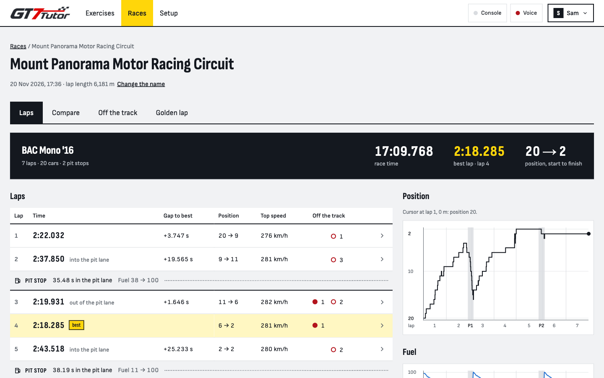

The band shows the car, the laps, the cars and the pit stops. It also shows the `race time`, the `best lap · lap <n>` and the position from the start to the finish, for example `20 → 2`.

| Column | Content |
| --- | --- |
| **Lap** | The number of the lap in the game |
| **Time** | The lap time. The best lap has the tag `best`. The in-lap and the out-lap have a pit lane note. |
| **Gap to best** | The lap time minus the time of the best lap |
| **Position** | The position at the start and at the end of the lap, for example `11 → 6` |
| **Top speed** | The highest speed of the lap |
| **Off the track** | The moments with all 4 wheels off (a red dot) and with 2 or 3 wheels off (a red ring) |

A pit stop row comes between the in-lap and the out-lap, with the time in the pit lane and the fuel.

Select a lap row to compare that lap with the reference lap. The **reference lap** is the fastest lap that is not lap 1 and has no pit stop. Usually it is the best lap. When it is another lap, the hint under the table names it.

The charts:

- **Position**: your position, lap by lap, over the race time. Grey bands mark the pit stops.
- **Fuel**: the fuel, lap by lap. This chart is on the screen only when the fuel changes during the race.
- **Speed**: the speed of each lap over the distance from the lap line. Each lap has its own colour. The line of the best lap is thicker. The turns are yellow bands.

On **Speed**, the legend has a button for each lap, for example **Lap 4**. Select a button to hide or show the line of that lap. **View** opens the chart in full screen. Press Esc or select **Back** to close it.

### Compare two laps

**Where:** the **Compare** tab of the race, or a row of the lap table.

The heading gives the gap of the two lap times, for example `Lap 7 is 2.020 s slower than lap 4`. Use the two lists to select the two laps.

The tab shows the same parts as the review of an attempt. These parts are the map with the two lines, **Differences by turn** and the charts. The other lap takes the place of the reference. See [Review an attempt](#review-an-attempt).

With an in-lap or an out-lap, a gap in the line is the pit lane.

`These two laps do not match. Choose another lap.`: GT7 Tutor could not put one lap on the line of the other.

### Off the track

**Where:** the **Off the track** tab of the race.

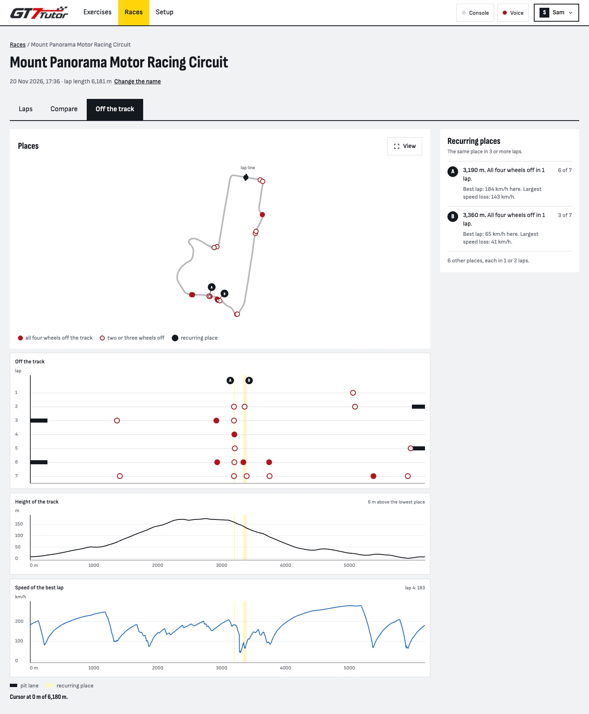

- **Places**: the map of the reference lap. A red dot marks a moment with all 4 wheels off. A red ring marks a moment with 2 or 3 wheels off. A black circle with a letter marks a recurring place.
- **Recurring places**: the places where you went off the track in 3 or more laps, for example `3,190 m. All 4 wheels off in 1 lap.` with the number of laps, for example `6 of 7`.
- **Off the track** (chart): one row for each lap, with a mark for each moment. A black bar marks the pit lane. Select a mark to see the lap, the wheels and the speeds.
- **Height of the track**: the height above the lowest place of the lap.
- **Speed of the best lap** (or **Speed of lap <n>**): the speed of the reference lap.

The recurring places are yellow bands on the charts.

### Golden lap

**Where:** the **Golden lap** tab of the race.

GT7 Tutor cuts each clean lap into parts, one part for each turn. Then it joins the fastest parts that fit together. At a join, the speeds of the two parts must not differ by more than 5 km/h. The lines must not differ by more than 1.5 m. A lap that leaves the track in a part gives no time for that part.

The band gives the `best clean lap`, the golden lap and the possible gain, for example `1:14.120`, `1:13.325` and `−0.795 s`.

**Turns** has one row for each turn:

| Column | Content |
| --- | --- |
| **Turn** | The turn, for example `T3` |
| **Part of the lap** | The distance of the part from the lap line |
| **Golden lap** | The time of the part in the golden lap and its lap |
| **Best** | The best time of the part in the clean laps and its lap |
| **Median** | The median time of the part in the clean laps |
| **Spread, best to median** | The median time minus the best time. A large spread shows a turn where your laps are not the same. You can find time there. |

The table opens with the largest spread first. Select a header to change the order.

A hint under a time of the **Golden lap** column tells you why the golden lap does not use a part:

- `Best 3.340 (lap 2) does not fit`: the best part does not fit the parts before or after it.
- `Lap 2 off track here`: this lap left the track in this part.

**Where each part comes from** shows the line of the lap with the colour of the lap of each part.

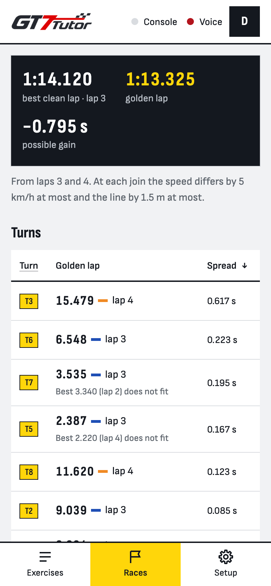

When the race has no golden lap, the tab shows `No golden lap for this race` and the reason. A golden lap needs 3 clean laps, and a clean lap with a time for each turn.

### Show the races of one track

When your races are on 2 or more tracks, the list has a **Track** field. Select a track to show only its races. Select **All tracks** to show all races. **Select** applies only to the races on the screen.

## Manage references

**Where:** the **References** tab of the exercise.

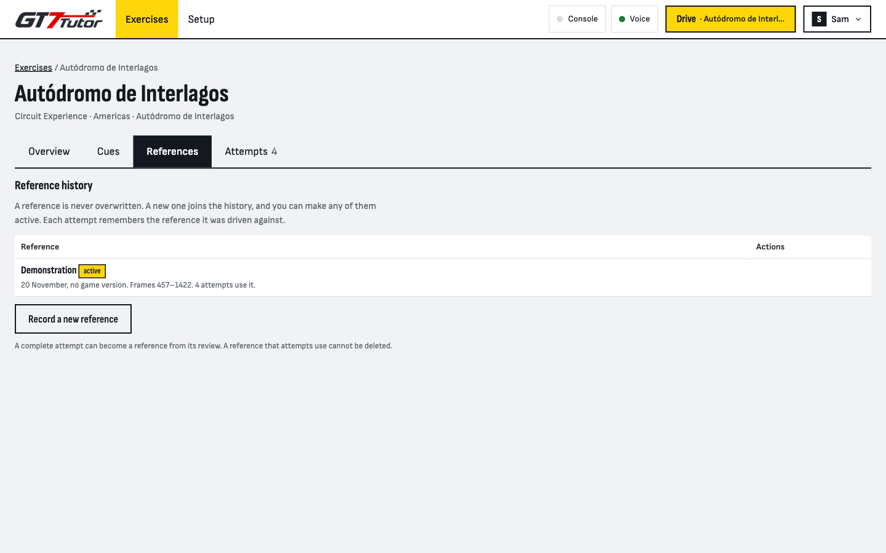

GT7 Tutor never overwrites a reference. Each new reference goes into the history. One reference is active. Each attempt keeps the reference that you drove it against.

- **Record a new reference** opens the recording screen.
- **Make active** (an attempt) or **Return to the demonstration** makes another reference active.
- **Needs a check**: you changed the **GT7 version** in **Setup** → **Preferences**. Select **Check with one recording** and record the demonstration once. GT7 Tutor then tells you if the reference still matches the game.
- **Delete** is available only for a reference that is not active and that no attempt uses.

## Profiles: sign in, sign out, switch, change and delete

**Where:** **Setup** → **Profiles**, or **Manage profiles** in the profile menu.

Each profile has its own exercises, references, attempts, races and voice device. One profile trains at a time.

### Add a profile

1. Select **+ Add a profile**.
2. Type a **Name** and a **Password** of at least 8 characters.
3. Select **Add profile**.

### Sign out and switch profiles

1. Select **Sign out** (in the profile menu or in **Profiles**).
2. On **Who is driving?**, select the profile.
3. Type its password and select **Sign in**.

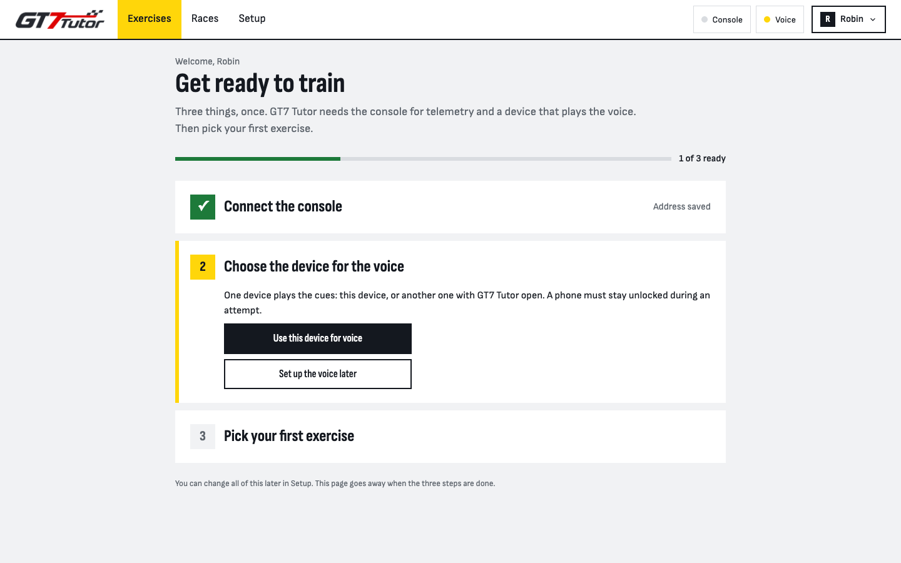

Everyone on your home network can see the profile names. After too many wrong passwords, GT7 Tutor shows `Too many failed sign-ins for this name.` Wait 15 minutes, then try again.

### Change the password

1. Select **Change password**.
2. Type the **Current password** and the **New password**.
3. Select **Save**.

GT7 Tutor signs out the other devices of this profile.

## Other settings

### Console

**Setup** → **Console** shows the **PS5 address** and the **Telemetry** state. **Save and check** saves the address and checks the reception. **Check again** shows the number of packets and the car.

The PS5 address can change after a router restart. Then type the new address and select **Save and check**.

### Voice

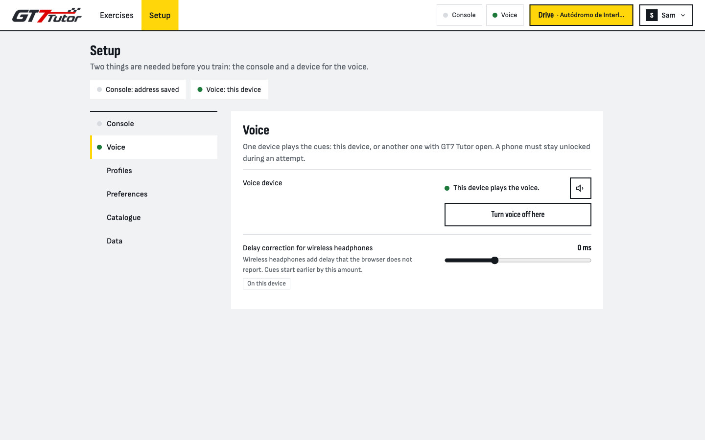

- **Use this device for voice** moves the voice to this device. The other device stops the voice.
- The speaker button (**Test**) plays `Voice check`.
- **Turn voice off here** stops the voice on this device. The Drive screen still shows the cues.
- **Delay correction for wireless headphones**: −200 ms to +400 ms, on this device. A positive value starts the cues earlier. If the voice sounds late, increase the value.

### Preferences

- **Theme**: **System**, **Light** or **Dark**. The Drive screen is always dark.
- **Screen updates while driving**: 15, 30 or 60 per second, on this device. A higher value moves the values and the map point more smoothly. It also uses more battery on a phone. The time of the voice cues does not change.
- **GT7 version**: GT7 Tutor stores it with each new reference. When you change it, the references of another version get **Needs a check**.

### Catalogue

The catalogue is the list of exercises that you can add.

1. Select the refresh button (**Check for updates**). GT7 Tutor reads the public sources over the internet. It sends no data about you or your driving.
2. Read the differences under `Added`, `Changed` and `Removed`.
3. Select **Apply update** to use the new catalogue.

An entry that has your exercises stays. After an update, **Restore** makes the previous catalogue active again.

## Delete data

You cannot undo a delete. A delete needs the training off: the delete button then says **Stop the training and delete**. While an attempt runs, you cannot delete.

| Action | Where | What goes | What stays |
| --- | --- | --- | --- |
| Delete one attempt | Review → **Delete attempt** | The attempt, its cues and differences | References, other attempts |
| Delete attempts | Attempts → **Select** → **Delete N attempts** | The marked attempts, their cues and differences | References |
| Delete a reference | References → **Delete** | The reference | Only possible when the reference is not active and no attempt uses it |
| Delete exercises | Exercises → **Select** → **Delete N exercises** | The exercises, their attempts, references, best time and target | The catalogue entries. You can record a reference again. |
| Delete races | Races → **Select** → **Delete N races** | The marked races with their laps, pit stops and places off the track | The exercises |
| Clean up captures | Setup → Data → **Clean up captures** | The parts of the raw captures that no reference, attempt or race uses | All references, attempts and races |
| Delete history: **Attempts of one exercise** | Setup → Data → **Delete history** | The attempts of the selected exercise | Its references, the other exercises, the races, the settings |
| Delete history: **All attempts** | Same | All attempts of your profile | Exercises, references, races, settings |
| Delete history: **Start over** | Same | All attempts, references, races and exercise progress of your profile | The profile, the password, the voice and console settings, the catalogue |
| Delete a profile | Setup → Profiles → **Delete profile** | The exercises, references, attempts, races and captures of the profile | Other profiles and the settings of this computer |

After a delete, the raw captures stay on the disk until a clean-up. When a dialog has **Also clean up the raw captures that nothing uses afterwards**, leave it on. Else select **Clean up captures**. A race takes about 2.4 MB of disk space per minute.

**Delete history:**

1. Select **Setup** → **Data** → **Delete history**.
2. Select what to delete. For **Attempts of one exercise**, select the **Exercise**.
3. Read **This deletes** and **This keeps**.
4. Type your profile name.
5. Select the red button, for example **Delete all attempts**.

**Delete a profile:**

1. Select **Setup** → **Profiles** → **Delete profile**.
2. Read the list of what goes.
3. Type the password of the profile.
4. Select **Delete profile**.

**Result:** GT7 Tutor signs you out and shows **Who is driving?**.

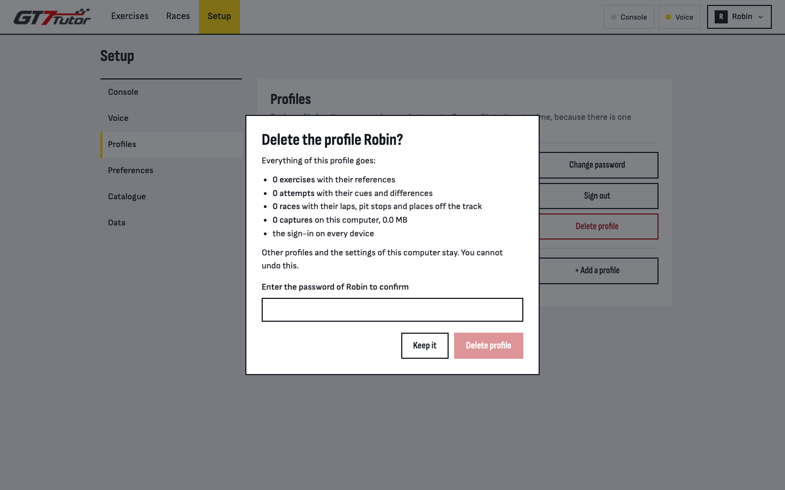

## Use a phone

The phone and the computer must be on the same home network.

1. Scan the QR code that `./start.sh` shows, or type the address for the phone, for example `http://192.168.0.10:3000`.
2. Sign in with your profile.
3. Select **Use this device for voice** if the phone must speak.

On a phone, **Exercises**, **Races** and **Setup** are in the bottom bar. The pages have one column.

| Exercises on a phone | Drive on a phone | A race on a phone |
| --- | --- | --- |
| 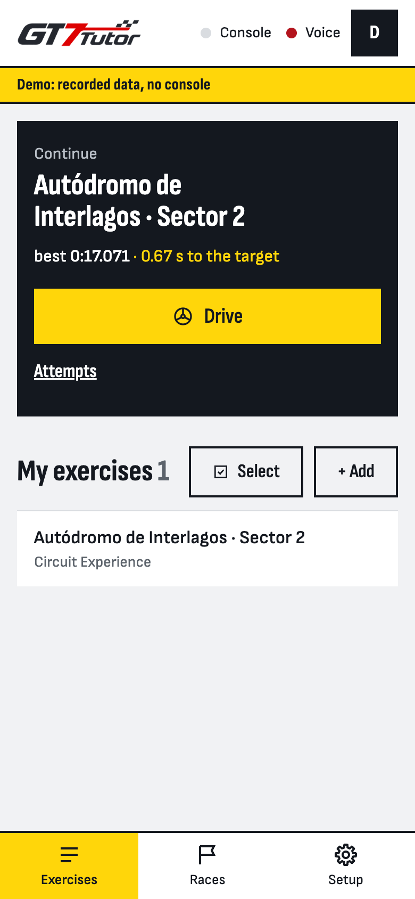 | 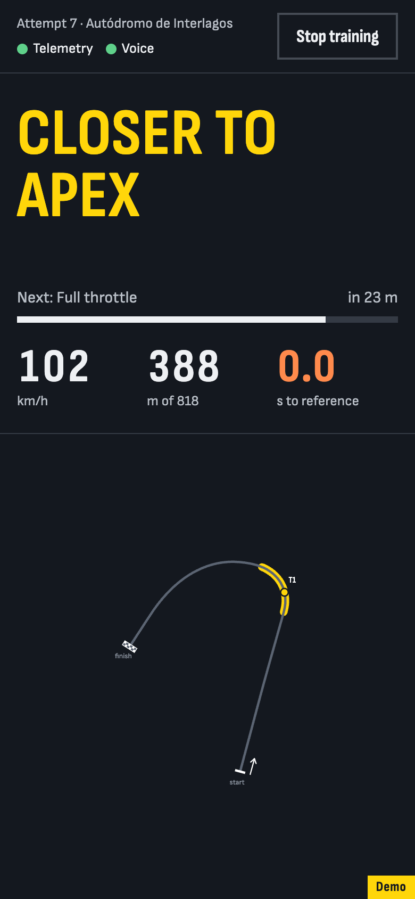 | 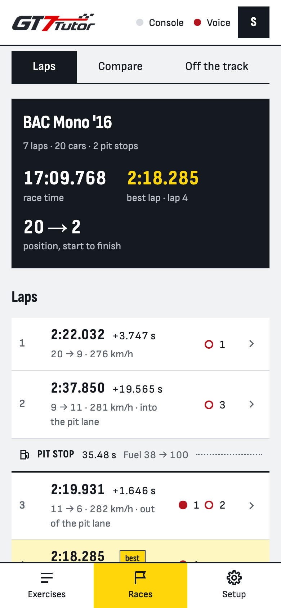 |

The recording screen on a phone fills the screen. Use **Start recording** and **Stop recording** at the bottom, and **Close** to go back.

Two limits come from the phone browser:

- A browser does not let a page start sound by itself. Tap **Use this device for voice** after you open or reload the page.
- A locked screen stops the sound. Set auto-lock to off while you drive.

## Try the demo

The demo shows GT7 Tutor with recorded data. You need no PS5. To start it, see the [README](../../README.md#try-the-demo-without-a-console).

1. Open the address that the start script shows. The label `Demo: recorded data, no console` is at the top of each screen.
2. On **Who is driving?**, the demo fills in the profile `demo` and its password. Select **Sign in**.
3. Select **Use this device for voice** in **Setup** → **Voice**.
4. Open the exercise, then the **Attempts** tab.
5. Select **Drive**. A recorded attempt plays in real time, with the cues on the screen and on the voice device.
6. After the summary, select **Review this attempt**.

The demo has its own database. It does not change your profiles. In the demo, you cannot change the console address, the password or the catalogue, and you cannot delete the profile. The demo has no race.

## Common problems

### No packets from the console

You see `No packets`, `Address saved, no telemetry yet` or `No packets from the console`.

1. Check that the PS5 is on and that GT7 runs past the title screen.
2. On the PS5, read the IPv4 address again. Compare it with **Setup** → **Console**.
3. Check that the computer accepts UDP on port 33740. On macOS, allow incoming connections for Node.js when the system asks. On Linux with `ufw`, run `sudo ufw allow 33740/udp`.
4. Select **Check again**.

### No sound

1. Examine the **Voice** dot in the top bar.
2. Select **Use this device for voice** again, then the speaker button.
3. Turn off the silent mode of the phone, and turn up the volume.
4. On an iPhone after a screen lock, reload the page, then select **Use this device for voice** again. See the [README](../../README.md#use-a-phone).

### The voice comes too late

1. With wireless headphones, increase **Delay correction for wireless headphones** in **Setup** → **Voice**.
2. For one cue, move **Timing** earlier on the **Cues** tab.
3. Examine **Brake reaction** in the review. It shows how long after the cue you start to brake.

### The attempt does not start

- The exercise was already running when you selected **Drive**. Restart the exercise in GT7.
- The game does not time this exercise from the start. GT7 Tutor cannot follow this exercise.

### No reference can be found

The game does not time the demonstration of this exercise, or the recording stopped before its end. Record again and let the demonstration play to the end. If it fails again, GT7 Tutor cannot follow this exercise.

### The page says the server did not answer

GT7 Tutor does not run on the computer. Start it with `./start.sh`, then reload the page.

### The race recording waits and does not start

The recording screen shows `WAITING`.

1. Examine the **Console** dot. Without telemetry, see [No packets from the console](#no-packets-from-the-console).
2. Start a race by laps in GT7. The recording starts on the grid, or at the next lap line when the race already runs.

### The recording of this race is no longer on the disk

The raw capture of the race is missing, for example after you deleted files in the data folder. The lap table and the band stay. **Compare**, **Speed** and the map of **Off the track** need the raw capture.
