# GT7 Tutor user guide

This guide shows how to use GT7 Tutor, from the first start to the review of your attempts.
To install and start GT7 Tutor, read the [README](../../README.md#quick-setup-macos-and-linux) first.

About the screenshots: they come from GT7 Tutor with recorded data from the project, not from a live PS5.
The recorded data is the Circuit Experience of Autódromo de Interlagos, sector 2.
On the screenshots, the console status can show `recorded data` or `Receiving telemetry`. With your PS5, the same screens show your own data.
The profile names `Sam` and `demo` are test names.

## Contents

1. [Words in this guide](#words-in-this-guide)
2. [What you need](#what-you-need)
3. [Create the first profile](#create-the-first-profile)
4. [Get ready: console, voice and first exercise](#get-ready-console-voice-and-first-exercise)
5. [Find your way in the application](#find-your-way-in-the-application)
6. [Add an exercise](#add-an-exercise)
7. [Record the reference](#record-the-reference)
8. [Set up the cues](#set-up-the-cues)
9. [Drive an attempt](#drive-an-attempt)
10. [Review an attempt](#review-an-attempt)
11. [See all attempts and recurring differences](#see-all-attempts-and-recurring-differences)
12. [Track your progress](#track-your-progress)
13. [Manage references](#manage-references)
14. [Profiles: sign in, sign out, switch, change and delete](#profiles-sign-in-sign-out-switch-change-and-delete)
15. [Other settings](#other-settings)
16. [Delete data](#delete-data)
17. [Use a phone](#use-a-phone)
18. [Try the demo](#try-the-demo)
19. [Common problems](#common-problems)

## Words in this guide

| Word | Meaning |
| --- | --- |
| Telemetry | The data that GT7 sends from the PS5 about 60 times per second: position, speed, pedals and the time of the run. GT7 Tutor reads only this data. It does not see the game picture. |
| Exercise | One task of the game that you want to practise, for example a licence test or a Circuit Experience sector. |
| Demonstration | The drive that the game shows before an exercise. |
| Reference | The recorded part of the demonstration that GT7 Tutor compares your drive with. The voice cues come from it. |
| Attempt | One run of the exercise that you drive. GT7 Tutor finds its start and finish by itself. |
| Cue | A short voice instruction at one place of the section, for example `Hard brake. One fifteen`. The Drive screen shows the same words. |
| Voice device | The one browser that plays the cues for your profile: the computer or a phone. |
| Difference | A place where your attempt is not the same as the reference, for example `Braked 17 m earlier`. A difference is not always a driver error. The reference is one recorded drive, not the best possible line. |
| Recurring difference | A difference at the same place in at least half of your last complete attempts. |
| Capture | The raw file of all telemetry that GT7 Tutor received during a recording or an attempt. |

## What you need

- GT7 Tutor runs on a computer with macOS or Linux on your home network. The [README](../../README.md#what-you-need) tells you how to install and start it.
- A PS5 with Gran Turismo 7 on the same network.
- A browser on that computer, or on a phone on the same network.
- To try GT7 Tutor without a PS5, start the demo. See [Try the demo](#try-the-demo).

## Create the first profile

**Goal:** get access to GT7 Tutor.
**When:** the first time that you open GT7 Tutor on this computer.

1. Open the address that `./start.sh` shows, for example `http://localhost:3000`.
2. On **Create the first profile**, type a **Name**.
3. Type a **Password** of at least 8 characters.
4. Select **Create profile**.

**Result:** GT7 Tutor signs you in and shows **Get ready to train**.

A profile keeps your exercises, references and attempts. The password keeps other people on your home network out of your profile.
GT7 Tutor uses plain HTTP. Do not make it reachable from the internet.

**Possible problems:**

- `The password needs at least 8 characters.`: type a longer password.
- `The server did not answer`: GT7 Tutor does not run. Start it again with `./start.sh`.

## Get ready: console, voice and first exercise

**Goal:** prepare the three things that a training needs.
**When:** after the first sign-in. The page shows until you save a console address and add an exercise.

The page **Get ready to train** has three steps. The bar shows how many steps are ready.

### Step 1: connect the console

1. On the PS5, open **Settings** → **Network** → **View Connection Status**. Read the **IPv4 Address**, for example `192.168.0.20`.
2. Start Gran Turismo 7 and go past the title screen. The console sends telemetry only when GT7 runs.
3. In GT7 Tutor, type the address in **PS5 address**.
4. Select the check button (**Save and check**).

**Result:** GT7 Tutor saves the address and listens for packets for a short time. The step shows one of these:

- `Receiving telemetry`: the connection works.
- `Address saved, no telemetry yet`: GT7 Tutor saved the address but received no packets. The step is marked done, but you cannot train yet. See [No packets from the console](#no-packets-from-the-console).

The address is for this computer. All profiles use it.

### Step 2: choose the device for the voice

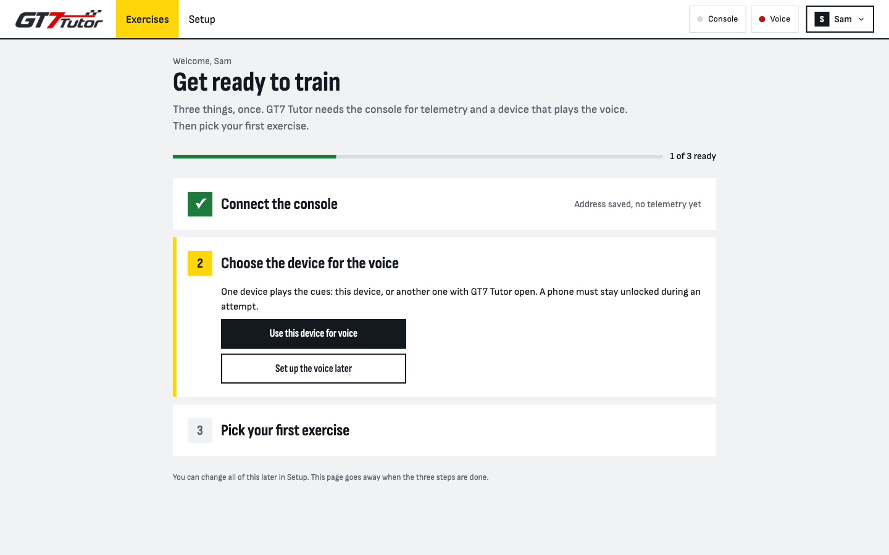

1. Open GT7 Tutor on the device that must play the cues: this computer, or a phone.
2. Select **Use this device for voice**.

**Result:** the step shows `This device`, and a speaker button appears. Select the speaker button to hear `Voice check`.

If you want to decide later, select **Set up the voice later**. You can choose the device in **Setup** → **Voice** at any time.
Without a voice device, the Drive screen still shows the cues.

### Step 3: pick your first exercise

Select **Add an exercise**. The next section tells you how to find the exercise.

## Find your way in the application

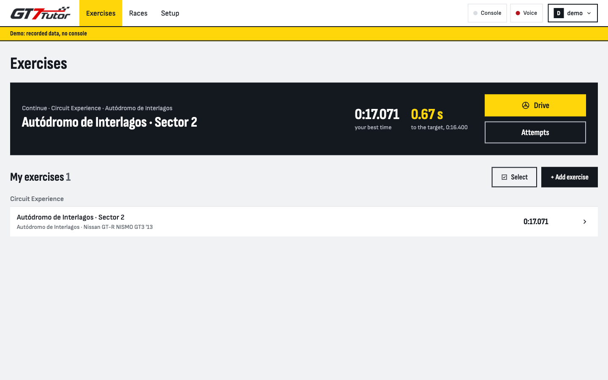

The application has three items in the menu:

| Item | On a computer | On a phone |
| --- | --- | --- |
| **Exercises**: your exercises, the catalogue and each exercise | Top bar | Bottom bar |
| **Drive**: the screen that you use while you drive | Top bar | Bottom bar |
| **Setup**: console, voice, profiles, preferences, catalogue, data | Top bar | Bottom bar |

The top bar also has:

- **Console** and **Voice**, each with a dot. The dot shows the state. Select one of them to open its Setup section.
- Your profile button with your initial and name. It opens a menu with **Manage profiles**, **Voice on this device**, **Theme** and **Sign out**.

The dots have these states:

| Dot | Green | Yellow | Red | Grey |
| --- | --- | --- | --- | --- |
| **Console** | `Receiving telemetry` | `Waiting for packets` | `No packets. Check the console address.` or `GT7 Tutor does not answer. Check that it runs on the computer.` | `No telemetry now. It starts with a recording, a training or a check.` |
| **Voice** | `This device plays the voice` or `Another device plays the voice` | `The sound did not start on this device` | `No device plays the voice` | |

The **current exercise** is the exercise that you opened last. **Drive** and the **Continue** card on the Exercises home use it.

Each exercise has a page with a header and four tabs.
The header has the breadcrumb `Exercises / <exercise name>`. Select **Exercises** in it to go back to the Exercises home.
Under the exercise name, one line gives the family, the collection with the code, and the track, for example `Licence · National B, B-4 · Alsace – Village`. An exercise that you created yourself shows only its family.

| Tab | Content |
| --- | --- |
| **Overview** | The next action, the times from the game, the recurring differences and the map of the reference |
| **Cues** | What the voice will say, and where |
| **References** | The history of the references of the exercise |
| **Attempts** | All attempts, by day, and the recurring differences. The tab shows the number of all attempts, also the attempts that did not finish. |

The review of an attempt keeps the header and the tabs of its exercise. The **Attempts** tab is marked there.

## Add an exercise

**Goal:** put an exercise of the game into **My exercises**.

1. Select **Exercises**, then **+ Add exercise** (on a phone: **+ Add**).
2. Find the exercise. Use one or more of these:
   - Type in the search field: a name, track, car or code, for example `B-3` or `Interlagos`.
   - Select a family: **All**, **Licence**, **Circuit Experience** or **Brand Central**.
   - Select a collection in **All collections**, for example `Americas` or `National B`.
   - Select a track in **All tracks**.
3. Select **Add** in the row of the exercise.

**Result:** GT7 Tutor opens the page of the new exercise. Its first step is **Record the reference**.

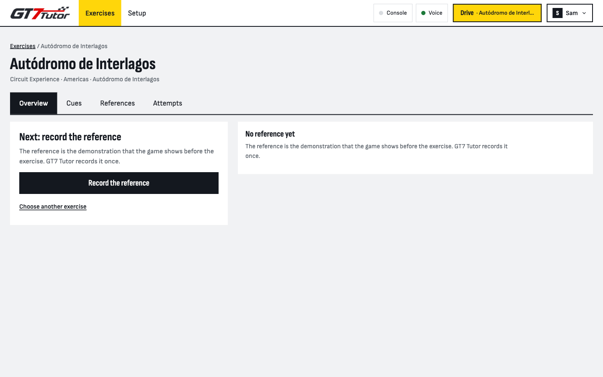

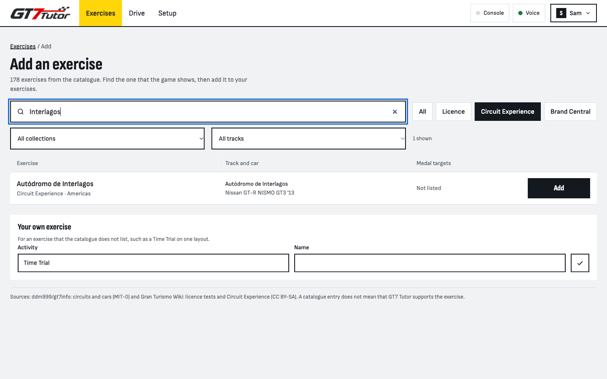

The column **Medal targets** shows the gold, silver and bronze times when the catalogue has them. `Not listed` means that the catalogue has no targets for the exercise.
An exercise that you already added shows **Added · open**.
`No exercise matches.`: check the spelling, or select **Clear filters**.

A catalogue entry does not mean that GT7 Tutor works for the exercise.
GT7 Tutor needs two things from the game: the game times the demonstration, and the game times your run from the start.

### Create your own exercise

Use this for an exercise that the catalogue does not list, for example a Time Trial on one layout.

1. At the bottom of **Add an exercise**, find **Your own exercise**.
2. Type the **Activity**. The default is `Time Trial`.
3. Type a **Name**.
4. Select the check button (**Create exercise**).

**Result:** GT7 Tutor opens the page of the new exercise.
Your own exercise has the same needs. If the game does not time a demonstration of the activity, you cannot record a reference for it.

### Delete an exercise

On the Exercises home, select **Select**, mark one or more exercises, then select **Delete N exercises**. The quick buttons **Without history**, **All** and **None** help you mark them.

For one exercise, the dialog lists what goes: the attempts with their cues and differences, the references, the best time and the medal. For more exercises, it lists each exercise with its attempts and references.
**Also clean up the raw captures that nothing uses afterwards** is on by default. Select **Delete exercise** (or **Delete N exercises**) to delete, or **Keep it** to close the dialog. You cannot undo it. The catalogue entry stays, so you can add the exercise again.

## Record the reference

**Goal:** give GT7 Tutor the drive that it compares your attempts with.
**Before you start:** the console address is saved, GT7 runs, and no other recording runs.

1. On the exercise page, select **Record the reference**.
2. In GT7, open the exercise. Stay on the screen before the demonstration.
3. In GT7 Tutor, select **Start recording**.
4. In GT7, start the demonstration.
5. Let the demonstration play to the end.
6. In GT7 Tutor, select **Stop recording 1**.

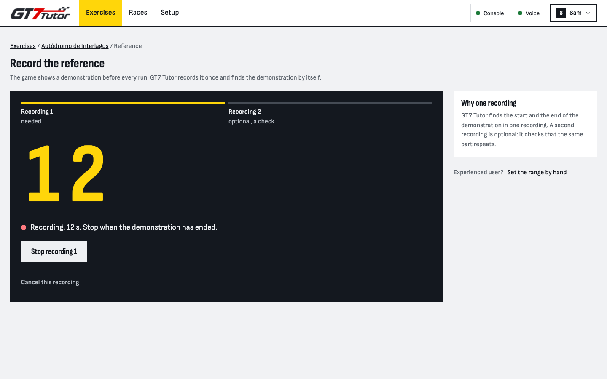

**Result:** GT7 Tutor finds the start and the end of the demonstration by itself. It shows **The demonstration is found** with its time and its frames.

1. Select **Use this as the reference**.

**Result:** `The reference is active`. Select **Hear the cues** to see what the voice will say, or **Back to the exercise**.

Other choices on this screen:

- **Record again to check** makes a second recording. GT7 Tutor then says if the same part repeats in both recordings. The check is optional.
- **Select the demonstration**: a recording can hold more than one demonstration. Select one, then continue.
- **Cancel this recording** stops the recording and does not use it.
- **Set the range by hand** is for an experienced user. Select a finished recording, then type the **First frame** and **Last frame** of the demonstration. GT7 Tutor keeps only the part of the range that holds the demonstration.

A recording needs the training off. When the training is on, the screen says `The training of <exercise> is on. A recording needs it off.` The button then says **Stop the training and record**. One click stops the training, then starts the recording. If the training does not stop, the screen shows the error and does not start the recording.
While an attempt runs, the screen says `Attempt <n> runs. Finish it or stop the training first.`, and you cannot start a recording.

**Possible problems:**

- `No complete demonstration found`: the recording does not hold the whole demonstration. Select **Record again** and let the demonstration play to the end.
- `Enter the PS5 address in Setup first.`: save the console address in **Setup** → **Console**.
- `Another recording or training runs. Stop it first.`: another recording runs, or another profile trains. A yellow bar at the top shows a running recording. Select **Stop recording** there.
- `This range does not hold the whole demonstration.`: in the range by hand, choose frames from before the start to after the end of the demonstration.

## Set up the cues

**Goal:** choose what the voice says, and when.
**Where:** the **Cues** tab of the exercise, or **Hear the cues first** on **Overview**.

The list shows each cue and each turn in the order of the section. Each cue row has:

- The distance from the start of the section and the phrase, for example `291 m`, `Hard brake. One fifteen`.
- The target speed in km/h, rounded down to 5. For a brake it is the lowest speed of the reference in that place, and the row says `lowest speed`. For a throttle cue it is the speed of the reference 2 s later. `–` means that the cue has no target speed, for example a brake to a stop: GT7 Tutor gives targets only from 30 to 350 km/h.
- **Hear** (play icon): plays the phrase on this device.
- **Mute** (speaker icon) / **Unmute** (crossed-out speaker on a black fill): a muted cue is not spoken. The Drive screen does not show it either. A muted row has a striped grey background, the phrase struck through and the tag `MUTED`. Its timing stays and applies again after **Unmute**.
- **Timing**: moves this cue up to 1 s earlier or 0.5 s later, in steps of 0.1 s.
- Notes from your attempts, for example `Braked early in 2 of 3 attempts, median 26 m`. A yellow row marks a place where a difference repeats.
- The tag `NOT SPOKEN`: on the reference line, the voice does not say this cue. The line under the phrase tells why. An example is `The voice still says cue 3 here. Mute cue 3 or this cue, or move cue 3 earlier.` The voice says one cue at a time, so a cue that comes too soon after another cue stays silent. The line above the list gives the number of these cues. A muted cue does not get this tag.

The turn rows (`T1`) show the turn-in, the apex, the radius and the speed of the reference at the apex. The voice does not say them.

Settings above the list:

- **Speak target speeds**: on, the voice says the lowest speed of the reference after a brake phrase. Off, it says the action only.
- **Side cue distance**: `Off`, or 0.5 m to 3 m. The voice says `More left` or `More right` when the car stays farther than this distance from the reference line.

The map is on the right, in a frame with the title `Reference line, <length> m`. The legend under the map has the words `reference line`, `turn`, `voice cue`, `muted cue`, `cue not spoken` and `Select a number to mute that cue`. **View** opens the map in full screen, with the list of the voice cues. Select a cue in the list to find it on the line. Press Esc or select **Back** to close the full-screen map. On a phone, the map is above the list of cues.

On the map, a yellow band marks each turn, from the turn-in to the end of the turn, with its label `T1`. A short bar and an arrow mark the start and the direction of travel, and a chequered bar marks the finish. Select a cue number to mute or unmute that cue. A muted cue has a dashed grey circle with a small crossed-out speaker. A cue with the tag `NOT SPOKEN` has a small black circle with three dots. When two cues are so close that their numbers would cover each other, the numbers move to the two sides of the line, with a short line to their places.

### Preview the cues

**Preview** (play icon, next to **View**) plays the cues on this device in the time of the reference. It uses the settings of this tab. Each cue plays at the time that a drive on the reference line gives it.

1. Select **Preview**. A yellow dot moves along the reference line.
2. Listen to the cues. The number of the cue that the voice says turns black on the map, and its row shows the tag `SPEAKING`. Under the map, a bar and the time show the progress, for example `0:11.3 of 0:16.1, measured`. The line `The voice says:` gives the phrase and the cue number.
3. To stop before the end, select **Stop** (square icon).

The preview stops by itself at the end of the reference. It also stops when you change a setting of this tab, and when you leave the tab. The preview does not start a training, and it does not record an attempt. **Preview** is only on the **Cues** tab. On a phone, **Preview**, **Stop** and **View** are icon buttons.

Changes apply from the next **Start an attempt**. A training that already runs keeps the old settings.

## Drive an attempt

**Goal:** drive the exercise with the cues on the screen and, if you want, on the voice device.
**Before you start:** the exercise has an active reference, and the console sends telemetry.

### Start

1. Select **Drive** in the menu.
2. Read the line `Exercise: <name>`. The name is a link to the exercise. On a computer, the line also shows where the exercise is. To pick another exercise, select **Change exercise**. It opens **Exercises**.
3. Look at the notice. If you see `No device plays the voice. The screen still shows the cues.`, select **Use this device for voice** when this device must speak. The notice also shows when this device has the voice but the sound did not start. If another device plays the voice, the notice does not show.
4. Select **Start an attempt**.

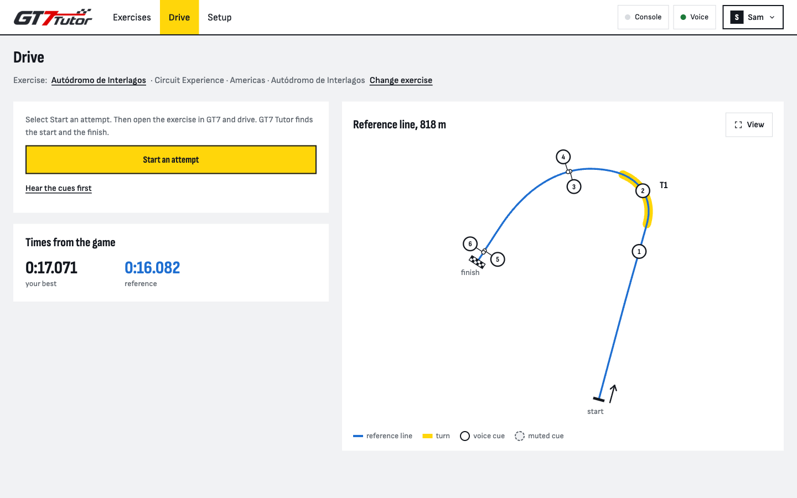

The screen has these parts:

| Part | Content |
| --- | --- |
| Hint | `Select Start an attempt. Then open the exercise in GT7 and drive. GT7 Tutor finds the start and the finish.` |
| **Hear the cues first** | Opens the **Cues** tab of the exercise. |
| **Times from the game** | Your best time, the time of the reference, and the time to the next medal. The panel shows only the times that GT7 Tutor knows. |
| **Reference line** | The map of the reference with its length, for example `Reference line, 818 m`. Select **View** to open it larger. |

An attempt can start without a voice device. If GT7 Tutor cannot load the voice clips, the message shows under **Start an attempt**.

**Result:** the dark Drive screen shows `READY` and `Waiting for the start`, and the first cue.

1. In GT7, start the exercise and drive. You do not need to touch GT7 Tutor.

GT7 Tutor finds the start and the finish of the attempt by itself. The time of the attempt is the time from the game.

### During the attempt

| Part | Meaning |
| --- | --- |
| Large words | The current cue, for example `HARD BRAKE 115` or `FULL THROTTLE 140`. The number has the size of the words. It shows for about 3 s. The cue area has one height for all cues, so the lines below it do not move. |
| `Cue 2 of 6 · before T1` | The number of the cue and the next turn |
| `Next: … in … m` | The next cue and the distance to it |
| km/h | Your speed |
| `m of 818` | Your distance on the reference |
| `s to reference` | Your time at this place minus the time of the reference at the same place. A positive value means that you are slower. |
| Map | Your position on the reference line. Each turn is a yellow band from the turn-in to the end of the turn, with its label, for example `T1`. A short bar and an arrow mark the start and the direction of travel; a chequered bar marks the finish. |
| **Telemetry**, **Voice** | The status dots. Green means ready. |

The voice speaks about half a second before the place where the reference does the action. Other cues:

- `Hard brake`, `Brake` or `Light brake`: the reference loses at least 40 %, at least 15 % or less than 15 % of its speed.
- `Lift off`: the reference takes the foot off the throttle and does not brake.
- `Throttle on` or `Full throttle`: the reference opens the throttle; `Full throttle` when it reaches full throttle within 2 s.
- `Big brake ahead` before a long, hard brake.
- `Closer to apex` when you run wide before an apex.
- `More left` or `More right`, if **Side cue distance** is on.
- `Guidance paused` and `Guidance resumed` when GT7 Tutor cannot follow your position.

When you pause the game, the screen shows `Paused. Cues stop until you continue.` The attempt continues after the pause.

### After the finish

The summary shows:

- The time from the game.
- **Focus for the next attempt**: one difference to work on, for example `Turn one. Brake earlier.` The voice device also says it. The focus names a turn, so it shows only when the difference is in a turn. An exercise without turns, for example a licence test on a straight, has no focus.
- **Gap to your best**, and **Largest difference**.

Then:

- **Review this attempt** opens the review.
- **Drive again** closes the summary. The training stays on. Restart the exercise in GT7 to drive the next attempt.
- **Stop training** at the top right ends the training.

An attempt that does not finish shows `No time` and the reason, for example `left the track`, `restarted` or `training stopped`. Only a complete attempt has a time.

### Drive with or without the voice

You decide which help you use:

- **With the voice:** a voice device is set. The voice says the cues.
- **Without the voice:** select **Turn voice off here** in **Setup** → **Voice**, or do not choose a voice device. The Drive screen shows `No device plays the voice. The screen still shows the cues.` The attempt starts and the screen shows the cues.
- **Without some cues:** mute them in the **Cues** tab.

GT7 Tutor compares every attempt with the reference from the game demonstration. It does not compare attempts with the voice against attempts without the voice.

### Stop

Select **Stop training** at the top right. If an attempt runs, GT7 Tutor stops it with the reason `training stopped`, and the attempt has no time.

### The training bar on the other screens

While the training is on, every screen except Drive shows a yellow bar under the top bar:

- `The training is on: <exercise>. Restart the exercise in GT7 to drive the next attempt.`
- While an attempt runs: `Attempt <n> runs: <exercise>. Stop training ends it without a time.`

On a phone, the bar shows only the first sentence.

- **Open Drive** opens the Drive screen.
- **Stop training** ends the training. If an attempt runs, the attempt has no time.

The training stays on when you open another screen. Stop it when you do not drive.

### Possible problems

- `The attempt did not start` with `The exercise was already running when you pressed Start.`: restart the exercise in GT7. Select **OK** to close the message.
- `No packets from the console. Check that GT7 is running and that the address in Setup is right.`: see [No packets from the console](#no-packets-from-the-console).
- `Connection to GT7 Tutor lost.`: the browser lost the server. Check that GT7 Tutor runs and that the device is on the home network.
- `This exercise has no reference yet. Record it first.`: select **Record the reference**.
- `The recording is incomplete`: GT7 Tutor could not write the whole capture to the disk. The cues continue. Check the free disk space.

## Review an attempt

**Goal:** see where and how your attempt is different from the reference.
**Where:** **Review this attempt** after the finish, or a row in the **Attempts** tab.

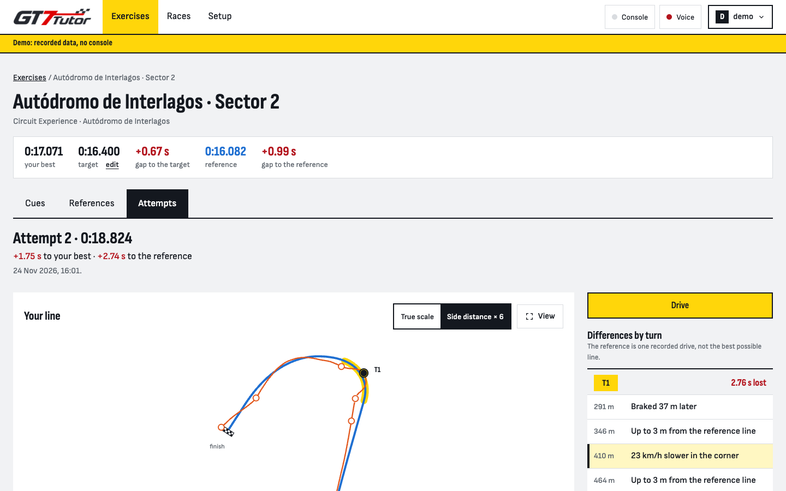

The review shows the header and the tabs of the exercise. Under them:

- **All attempts** goes back to the **Attempts** tab.
- The attempt number, the time from the game and the gap to the reference, for example `Attempt 1 · 0:18.824 +2.74 s`.
- On a computer, **Drive again** is at the top of the right column. On a phone, it is under the date of the attempt.

| Part | What it shows |
| --- | --- |
| **Your line** | The map with the reference line (blue) and your line (orange). A circle marks a difference. The legend has the words `reference line`, `you`, `turn` and `A gap in your line is a place without a match`. A gap is a place where GT7 Tutor could not match your position. |
| **True scale** / **Side distance × 6** | **Side distance × 6** draws your line 6 times farther from the reference line, so that a difference of 1 m shows. The labels give the true distance. The legend then also has `more than <n> m from the line` for the parts beyond the **Side cue distance**. On a phone, the two buttons are in a row under the title. |
| **View** | Opens the map in full screen, with your line in true scale and the list of the differences. Select a difference in the list to find it on your line. Press Esc or select **Back** to close. |
| **Differences by turn** | The differences, grouped by turn, with the time lost or gained in each turn. **Track** or **Time lost** sets the order. Select a difference to put the cursor there. A section without turns shows one group, **Whole section**. `No differences above the limits in this attempt.` means that GT7 Tutor found no difference. |
| **Corners** | Your line at each apex: on the line, or the distance inside or outside, and your speed at the apex. A section without turns has no **Corners**. |
| **Brake reaction** | The time from the start of a spoken brake cue to your brake. A value `before the cue` means that you braked before the voice. |
| Charts | Speed, throttle, brake, the distance from the reference line, and the time lost. Move the pointer or a finger across a chart. The map shows the same place. |
| **Compare with** | Another reference of the exercise. The review then compares the same attempt with that reference. |

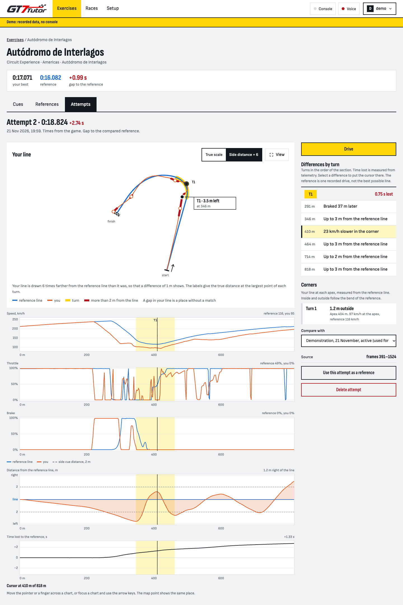

Read a difference with care. `Braked 37 m later` compares your brake that is nearest to the brake of the reference, within 60 m. If you pressed the brake two times, the charts show both.

Other actions under **Source**:

- **Use this attempt as a reference** (complete attempts only): the attempt becomes the active reference. The demonstration stays in the reference history.
- **Delete attempt**: opens a dialog that shows what goes. **Delete attempt** in the dialog deletes the attempt with its cues and differences. **Keep it** closes the dialog. See [Delete data](#delete-data).
- **Drive again** opens Drive for this exercise.

## See all attempts and recurring differences

**Where:** the **Attempts** tab of the exercise.

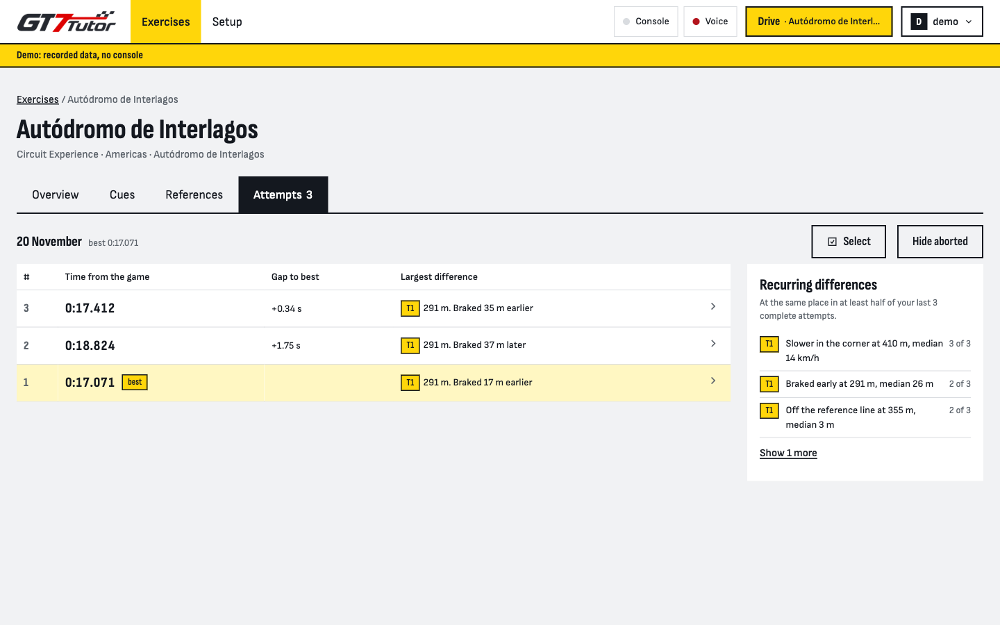

- Attempts are grouped by day. Each day shows its best time.
- **Time from the game**: the time of a complete attempt. `No time` and `aborted` with the reason for an attempt that did not finish.
- **Gap to best** and **Largest difference**. On a phone, the row shows the largest difference under the time.
- Select a row to open the review of the attempt.
- **Hide aborted** hides the attempts that did not finish. The button then says **Show aborted** and is filled. Select **Show aborted** to show the attempts again.
- **Select** lets you mark attempts and delete them. In this mode, a click on a row marks the attempt and does not open the review. See [Delete data](#delete-data).

**Recurring differences** lists the differences at the same place in at least half of your last complete attempts. GT7 Tutor uses the last 8 complete attempts and compares them with the active reference. You need at least three complete attempts. `No difference repeats in your last attempts.` means that no difference reaches half of them.

## Track your progress

The **Exercises** home shows:

- **Continue**: the current exercise, the next step, for example `Next: drive attempts`, your best time and the gap to the next medal. The main button shows the next action: **Record the reference**, **Start an attempt** or **Open the attempts**.
- **My exercises**: each exercise in one row, with its status tag and, on a computer, its best time. On a computer, buttons filter the list by family, for example **All**, **Licence** and **Circuit Experience**. The filter shows only the families of your exercises, and only when you have exercises of more than one family.

| Status | Meaning |
| --- | --- |
| New | No reference yet |
| Ready | An active reference, no complete attempt yet |
| Practising | Complete attempts, no medal yet, or no medal targets |
| Bronze, Silver, Gold | The medal that your best time from the game reaches |

The next step of an exercise moves by itself. `Next: record the reference` shows until an active reference exists. Then `Next: drive attempts` shows. `Next: review your attempts` comes after 3 complete attempts against the active reference.

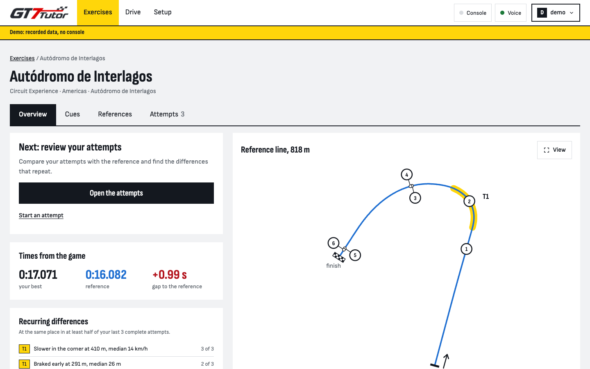

The **Overview** tab shows the next step, **Times from the game** (your best, the reference and the gap) and **Recurring differences**. **Recurring differences** shows the same rows as the **Attempts** tab. It shows only when a difference repeats in your last complete attempts. The map has the same frame as on the **Cues** tab. **View** opens the map in full screen.

## Manage references

**Where:** the **References** tab of the exercise.

A reference is never overwritten. Each new reference joins the history. One reference is active. Each attempt remembers the reference that it was driven against.

- **Record a new reference** opens the recording screen.
- **Make active** (an attempt) or **Return to the demonstration** makes another reference active.
- **Needs a check**: you changed the **GT7 version** in **Setup** → **Preferences**, and this reference was recorded with another version or with no version. Select **Check with one recording** and record the demonstration once. GT7 Tutor then says if the reference still matches the game.
- **Delete** shows only for a reference that is not active and that no attempt uses. It opens a dialog. Select **Delete reference** to delete the reference, or **Keep it** to close the dialog.

## Profiles: sign in, sign out, switch, change and delete

**Where:** **Setup** → **Profiles**, or **Manage profiles** in the profile menu.

Each profile has its own exercises, references, attempts and voice device. One profile trains at a time, because there is one console. The console address is for the whole computer.

### Add a profile

1. Select **+ Add a profile**.
2. Type a **Name** and a **Password** of at least 8 characters.
3. Select **Add profile**.

**Result:** `Profile <name> is ready. Sign out to use it.`

### Sign out and switch profiles

1. Select **Sign out** (in the profile menu or in **Profiles**).
2. On **Who is driving?**, select the profile.
3. Type its password and select **Sign in**.

Everyone on your home network can see the profile names. After too many wrong passwords for one name, GT7 Tutor shows `Too many failed sign-ins for this name.` Wait 15 minutes, then try again.

### Change the password

1. Select **Change password**.
2. Type the **Current password** and the **New password** (at least 8 characters).
3. Select **Save**.

Other devices that use this profile are signed out. This device stays signed in.

### Delete a profile

See [Delete data](#delete-data).

## Other settings

### Console

**Setup** → **Console** shows the **PS5 address** and the **Telemetry** state as text. A red text marks a problem: `GT7 Tutor does not answer. Check that it runs on the computer.` or `No packets. Check the console address.` **Save and check** saves the address and checks the reception. **Check again** listens for packets again and shows the number of packets and the car.

The computer must accept UDP on port 33740. If the check finds no packets, allow the port in the firewall.

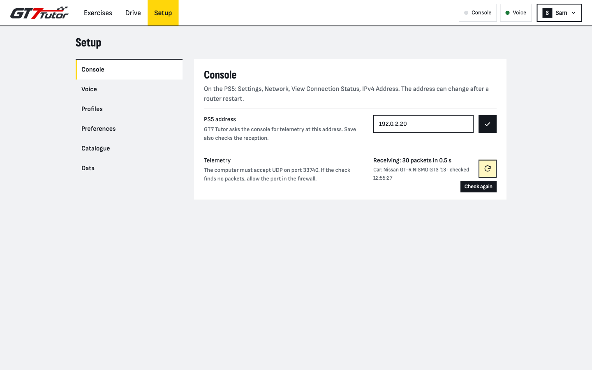

The PS5 address can change after a router restart. Then type the new address and select **Save and check**.

### Voice

The **Voice device** line shows one of these texts:

- `This device plays the voice.`
- `Another device plays the voice. This device stays silent.`
- `No device plays the voice.`
- `The browser did not start the sound on this device. Select Use this device for voice again.` The text is red.

- **Use this device for voice** moves the voice to this device. The other device stops to play cues.
- The speaker button (**Test**) plays `Voice check`. The message gives the output delay that the browser reports. This is not a measurement.
- **Turn voice off here** stops the voice on this device. The Drive screen still shows the cues.
- **Delay correction for wireless headphones**: −200 ms to +400 ms. It applies on this device. Wireless headphones add a delay that the browser does not know. A positive value starts the cues earlier. If the voice sounds late, increase the value.

### Preferences

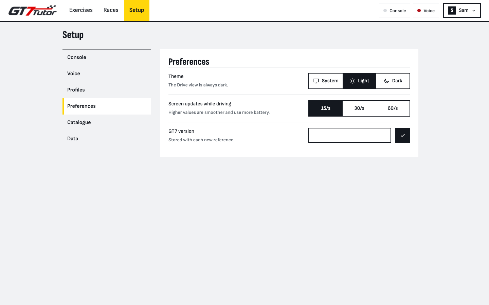

- **Theme**: **System**, **Light** or **Dark**. The Drive screen is always dark.
- **Screen updates while driving**: 15, 30 or 60 per second. The default is 15. The setting applies to the browser where you change it, on a computer or on a phone. Each device keeps its own value. A higher value moves the speed, the distance, the gap and the map point more smoothly. It also uses more network, more battery on a phone or a laptop, and can make the page slower on an older phone. The voice cues arrive at once with every value.
- **GT7 version**: GT7 Tutor stores it with each new reference. When you change it, the references of another version get **Needs a check**.

### Catalogue

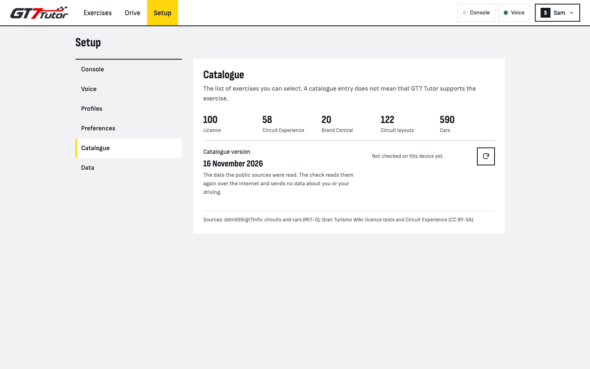

The catalogue is the list of exercises that you can add. **Catalogue version** is the date when the project read the public sources.

1. Select the refresh button (**Check for updates**). GT7 Tutor reads the public sources again over the internet. It sends no data about you or your driving.
2. Read the differences: **Added**, **Changed** and **Removed**. Nothing changes yet.
3. Select **Apply update** to use the new catalogue.

An entry that has your exercises stays. After an update, **Restore** makes the previous catalogue active again.

## Delete data

**Before you delete:** you cannot undo any of these actions.

| Action | Where | What goes | What stays |
| --- | --- | --- | --- |
| Delete one attempt | Review → **Delete attempt** | The attempt, its cues and differences | References, other attempts. The raw capture stays until a clean-up. |
| Delete several attempts | Attempts → **Select** → **Delete N attempts** | The selected attempts, their cues and differences. Your best time and the recurring differences are counted again. | References. The raw captures stay until a clean-up. |
| Delete a reference | References → **Delete** → **Delete reference** | The reference | Only possible when the reference is not active and no attempt uses it |
| Delete an exercise | Exercises → **Select** → **Delete N exercises** | The exercise, its attempts, references, best time and medal | The catalogue entry. You can add the exercise again. |
| Clean up captures | Setup → Data → **Clean up captures** | The parts of the raw captures that no reference and no attempt uses | All references and attempts |
| Delete history: **Attempts of one exercise** | Setup → Data → **Delete history** | The attempts of the selected exercise | Its references, the other exercises, the settings |
| Delete history: **All attempts** | Same | All attempts of your profile | Exercises, references, settings |
| Delete history: **Start over** | Same | All attempts, references and exercise progress of your profile | The profile, the password, the voice and console settings, the catalogue |
| Delete a profile | Setup → Profiles → **Delete profile** | The exercises, references, attempts and captures of the profile, and its sign-in on every device | Other profiles and the settings of this computer |

A delete needs the training off. When the training is on, a delete dialog and the **Delete history** page say `The training of <exercise> is on. It stops when you delete.` The delete button then says **Stop the training and delete**. One click stops the training, then deletes. If the training does not stop, GT7 Tutor shows the error and does not delete.
While an attempt runs, the dialog says `Attempt <n> runs. Finish it or stop the training first.`, and you cannot delete.

**Delete history:**

1. Select **Setup** → **Data** → **Delete history**.
2. Select what to delete. For **Attempts of one exercise**, select the **Exercise**.
3. Leave **Also clean up the raw captures that nothing uses afterwards** on to free disk space.
4. Read **This deletes** and **This keeps**.
5. Type your profile name to confirm.
6. Select the red button, for example **Delete all attempts**.

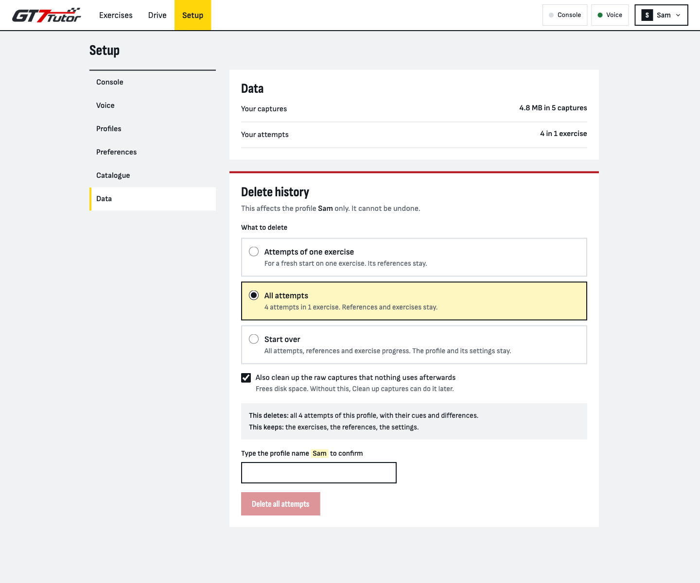

**Delete a profile:**

1. Select **Setup** → **Profiles** → **Delete profile**.
2. Read the list of what goes.
3. Type the password of the profile.
4. Select **Delete profile**.

**Result:** GT7 Tutor signs you out and shows **Who is driving?**.

## Use a phone

The phone and the computer must be on the same home network.

1. Scan the QR code that `./start.sh` shows, or type the address for the phone, for example `http://192.168.0.10:3000`.
2. Sign in with your profile.
3. Select **Use this device for voice** if the phone must speak.

On a phone, **Exercises**, **Drive** and **Setup** are in the bottom bar. Setup shows all its sections on one page.

| Exercises on a phone | Drive on a phone |
| --- | --- |
|  |  |

The recording screen on a phone fills the screen. Use **Start recording** and **Stop recording** at the bottom, and **Close** to go back.

Two limits come from the phone browser:

- A browser does not let a page start sound by itself. Tap **Use this device for voice** after you open or reload the page.
- A locked screen stops the sound. Turn off auto-lock during a session.

## Try the demo

The demo shows GT7 Tutor with recorded data. You need no PS5. To start it, see the [README](../../README.md#try-the-demo-without-a-console).

1. Open the address that the start script shows. A yellow label `Demo: recorded data, no console` is at the top of each screen.
2. On **Who is driving?**, the profile `demo` and its password are filled in. Select **Sign in**.
3. Select **Drive**, then **Use this device for voice**.
4. Select **Play a demo attempt**. A recorded attempt plays in real time, with the cues on the screen and on the voice device.
5. After the summary, select **Review this attempt**.

The demo has its own database. It does not change your profiles.
In the demo, you cannot change the console address, the password or the catalogue, and you cannot delete the profile.

## Common problems

### No packets from the console

You see `No packets`, `Address saved, no telemetry yet` or `No packets from the console`.

1. Check that the PS5 is on and that GT7 runs past the title screen.
2. On the PS5, read the IPv4 address again. Compare it with **Setup** → **Console**.
3. Check that the computer accepts UDP on port 33740. On macOS, allow incoming connections for Node.js when the system asks. On Linux with `ufw`, run `sudo ufw allow 33740/udp`.
4. Select **Check again**.

### No sound

1. Look at the **Voice** dot in the top bar. Yellow means `The sound did not start on this device`. Red means `No device plays the voice`.
2. Select **Use this device for voice** again, then the speaker button.
3. Turn off the silent mode of the phone, and turn up the volume.
4. On an iPhone after a screen lock, reload the page, then select **Use this device for voice** again. See the [README](../../README.md#use-a-phone).

### The voice comes too late

1. With wireless headphones, increase **Delay correction for wireless headphones** in **Setup** → **Voice**.
2. For one cue, move **Timing** earlier in the **Cues** tab.
3. Check **Brake reaction** in the review. It shows how long after the cue you start to brake.

### The attempt does not start

- The exercise was already running when you selected **Start an attempt**. Restart the exercise in GT7.
- The game does not time this exercise from the start. GT7 Tutor cannot follow this exercise.

### No reference can be found

The game does not time the demonstration of this exercise, or the recording stopped before its end. Record again and let the demonstration play to the end. If it fails again, GT7 Tutor cannot follow this exercise.

### The page says the server did not answer

GT7 Tutor does not run on the computer. Start it with `./start.sh`, then reload the page.
