# GT7 Tutor user guide

This guide shows how to use GT7 Tutor, from the first start to the review of your attempts and your races.
To install and start GT7 Tutor, read the [README](../../README.md#quick-setup-macos-and-linux) first.

About the screenshots: they come from GT7 Tutor with recorded data from the project, not from a live PS5.
The recorded data of the exercises is the Circuit Experience of Autódromo de Interlagos, sector 2. The recorded data of the races is two races of 5 and 7 laps.
On the screenshots, the console status can show `recorded data` or `Receiving telemetry`. With your PS5, the same screens show your own data.
The profile names `Sam` and `demo` are test names.

## Contents

1. [Words in this guide](#words-in-this-guide)
2. [What you need](#what-you-need)
3. [Create the first profile](#create-the-first-profile)
4. [Get ready: console, voice and first exercise](#get-ready-console-voice-and-first-exercise)
5. [Find your way in the application](#find-your-way-in-the-application)
6. [Choose an exercise](#choose-an-exercise)
7. [Record the reference](#record-the-reference)
8. [Set up the cues](#set-up-the-cues)
9. [Drive an attempt](#drive-an-attempt)
10. [Review an attempt](#review-an-attempt)
11. [See all attempts and recurring differences](#see-all-attempts-and-recurring-differences)
12. [Track your progress](#track-your-progress)
13. [Record a race and look at it](#record-a-race-and-look-at-it)
14. [Manage references](#manage-references)
15. [Profiles: sign in, sign out, switch, change and delete](#profiles-sign-in-sign-out-switch-change-and-delete)
16. [Other settings](#other-settings)
17. [Delete data](#delete-data)
18. [Use a phone](#use-a-phone)
19. [Try the demo](#try-the-demo)
20. [Common problems](#common-problems)

## Words in this guide

| Word | Meaning |
| --- | --- |
| Telemetry | The data that GT7 sends from the PS5 about 60 times per second: position, speed, pedals and the time of the run. GT7 Tutor reads only this data. It does not see the game picture. |
| Exercise | One task of the game that you want to practise, for example a licence test or a Circuit Experience sector. |
| Demonstration | The drive that the game shows before an exercise. |
| Reference | The recorded part of the demonstration that GT7 Tutor compares your drive with. The voice cues come from it. |
| Attempt | One run of the exercise that you drive. GT7 Tutor finds its start and finish by itself. |
| Cue | A short voice instruction at one place of the section, for example `Hard brake. One fifteen`. The Drive screen shows the same words. |
| Voice device | The one browser that plays the cues for your profile: the computer or a phone. |
| Difference | A place where your attempt is not the same as the reference, for example `Braked 17 m earlier`. A difference is not always a driver error. The reference is one recorded drive, not the best possible line. |
| Recurring difference | A difference at the same place in at least half of your last complete attempts. |
| Capture | The raw file of all telemetry that GT7 Tutor received during a recording, an attempt or a race. |
| Race | A race by laps in the game that GT7 Tutor recorded, from the start or the first recorded lap line to the finish. |
| Lap | One lap of a race, from one lap line to the next. A lap keeps the number that the game gives it. |
| Best lap | The lap of the race with the shortest lap time of the game. A lap with a pit stop does not count. When each lap has a pit stop, the fastest lap is the best lap. |
| Pit stop | A stop in the pit lane between two laps. The lap before the stop is the in-lap. The lap after it is the out-lap. |
| Off the track | A moment with two or more wheels on a surface that is not the track or a kerb, for example grass or gravel. |
| Recurring place | A place of the track where you went off the track in 3 or more laps of one race. |
| Clean lap | A lap of a race that is not lap 1 and has no pit stop. When the recording starts after lap 1, the first recorded lap is not clean either. |
| Golden lap | The fastest lap that you can drive from parts of the clean laps of one race. The parts must fit together at each join. |

## What you need

- GT7 Tutor runs on a computer with macOS or Linux on your home network. The [README](../../README.md#what-you-need) tells you how to install and start it.
- A PS5 with Gran Turismo 7 on the same network.
- A browser on that computer, or on a phone on the same network.
- To try GT7 Tutor without a PS5, start the demo. See [Try the demo](#try-the-demo).

## Create the first profile

**Goal:** get access to GT7 Tutor.
**When:** the first time that you open GT7 Tutor on this computer.

1. Open the address that `./start.sh` shows, for example `http://localhost:3000`.
2. On **Create the first profile**, type a **Name**.
3. Type a **Password** of at least 8 characters.
4. Select **Create profile**.

**Result:** GT7 Tutor signs you in and shows **Get ready to train**.

A profile keeps your exercises, references and attempts. The password keeps other people on your home network out of your profile.
GT7 Tutor uses plain HTTP. Do not make it reachable from the internet.

**Possible problems:**

- `The password needs at least 8 characters.`: type a longer password.
- `The server did not answer`: GT7 Tutor does not run. Start it again with `./start.sh`.

## Get ready: console, voice and first exercise

**Goal:** prepare the three things that a training needs.
**When:** after the first sign-in. The page shows on the Exercises page until you save a console address.

The page **Get ready to train** has three steps. The bar shows how many steps are ready.

### Step 1: connect the console

1. On the PS5, open **Settings** → **Network** → **View Connection Status**. Read the **IPv4 Address**, for example `192.168.0.20`.
2. Start Gran Turismo 7 and go past the title screen. The console sends telemetry only when GT7 runs.
3. In GT7 Tutor, type the address in **PS5 address**.
4. Select the check button (**Save and check**).

**Result:** GT7 Tutor saves the address and listens for packets for a short time. The step shows one of these:

- `Receiving telemetry`: the connection works.
- `Address saved, no telemetry yet`: GT7 Tutor saved the address but received no packets. GT7 Tutor marks the step done, but you cannot train yet. See [No packets from the console](#no-packets-from-the-console).

The address is for this computer. All profiles use it.

### Step 2: choose the device for the voice

1. Open GT7 Tutor on the device that must play the cues: this computer, or a phone.
2. Select **Use this device for voice**.

**Result:** the step shows `This device`, and a speaker button appears. Select the speaker button to hear `Voice check`.

If you want to decide later, select **Set up the voice later**. You can choose the device in **Setup** → **Voice** at any time.
Without a voice device, the Drive screen still shows the cues.

### Step 3: pick your first exercise

Select **Choose an exercise**. The Exercises page opens. The next section tells you how to find the exercise.
When your profile already has exercises, step 3 shows `Done` and the button **Open the exercises**.

## Find your way in the application

The application has three items in the menu:

| Item | On a computer | On a phone |
| --- | --- | --- |
| **Exercises**: your exercises, the catalogue and each exercise | Top bar | Bottom bar |
| **Races**: the races that you recorded, by day, and **Record a race** | Top bar | Bottom bar |
| **Setup**: console, voice, profiles, preferences, catalogue, data | Top bar | Bottom bar |

There is no Drive item in the menu. The yellow **Drive** button starts an attempt. It is on the **Attempts** tab, on the review of an attempt and on the **Continue** card. See [Drive an attempt](#drive-an-attempt).

The top bar also has:

- **Console** and **Voice**, each with a dot. The dot shows the state. Select one of them to open its Setup section.
- Your profile button with your initial and name. It opens a menu with **Manage profiles**, **Voice on this device**, **Theme** and **Sign out**.

The dots have these states:

| Dot | Green | Yellow | Red | Grey |
| --- | --- | --- | --- | --- |
| **Console** | `Receiving telemetry` | `Waiting for packets` | `No packets. Check the console address.` or `GT7 Tutor does not answer. Check that it runs on the computer.` | `No telemetry now. It starts with a recording, a training or a check.` |
| **Voice** | `This device plays the voice` or `Another device plays the voice` | `The sound did not start on this device` | `No device plays the voice` | |

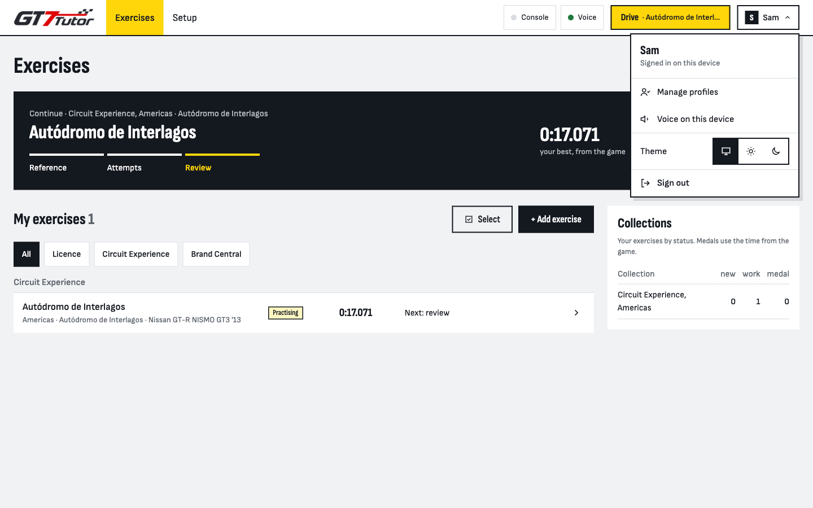

The **Continue** card on the Exercises page shows the **current exercise**. GT7 Tutor selects it in this order:

1. The exercise of the training that runs.
2. The exercise that you opened last, when it has a reference and no attempt yet.
3. The exercise of your last attempt. This is the same on all your devices.
4. The exercise that you opened last.
5. The exercise that you created last.

The title of an exercise is the same on all screens. A licence test shows the licence and the code, for example `National B, B-5`. A Brand Central exercise shows the brand and the code, for example `Yangwang, EXP-1`. The name of these exercises, for example `Cornering Basics 3`, is in the line under the title. A Circuit Experience sector shows its name, for example `Tsukuba Circuit · Sector 1`. An exercise that you created yourself shows its name.

Each exercise has a page with a header and, after the first reference or attempt, three tabs.
The header has the breadcrumb `Exercises / <exercise title>`. Select **Exercises** in it to go back to the Exercises page.
Under the title, one line gives the family, the name and the track, for example `Licence · Cornering Basics 3 · Tsukuba Circuit`. A Circuit Experience sector shows the family and the track, for example `Circuit Experience · Tsukuba Circuit`. An exercise that you created yourself shows its family and `Own exercises`.
Under that line, a band shows these times:

- `your best`: your best time, when the exercise has a complete attempt.
- `target`: the time that you want to reach. Without a target, the band shows `–`. See [Set the target](#set-the-target).
- `gap to the target`: your best time minus the target. It shows when the exercise has a best time and a target.
- `reference`: the time of the active reference, and the `gap to the reference`.

The band also shows on a new exercise, with `–` and **edit**.

The tabs show when the exercise has a reference or an attempt. A new exercise shows only the band and the **Cues** content.

| Tab | Content |
| --- | --- |
| **Cues** | What the voice will say, and where. The exercise opens on this tab. |
| **References** | The history of the references of the exercise |
| **Attempts** | The **Drive** button, all attempts by day, and the recurring differences |

The review of an attempt keeps the header and the tabs of its exercise. GT7 Tutor marks the **Attempts** tab there.

Each race has a page with the breadcrumb `Races / <track name>` and four tabs: **Laps**, **Compare**, **Off the track** and **Golden lap**. See [Record a race and look at it](#record-a-race-and-look-at-it).

## Choose an exercise

**Goal:** find an exercise of the game and record its first reference.

The Exercises page shows your exercises and the whole catalogue on one page. A catalogue entry becomes your exercise when you record its first reference. The address of the page is `/exercises`.

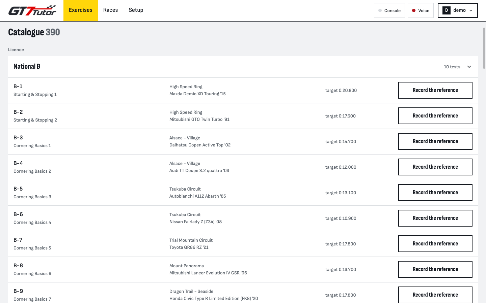

1. Select **Exercises**.
2. Find the exercise. Use one or more of these:
   - Type in the search field: a name, code, track or car, for example `B-3` or `Interlagos`.
   - Select a family: **All**, **Licence**, **Circuit Experience**, **Brand Central** or **Own**.
   - Select a track in **All tracks**.
3. Under **Catalogue**, select the group of the exercise to open it, for example `National B`. A search or a track opens all groups that have a match.
4. Select **Record the reference** in the row of the exercise.

**Result:** GT7 Tutor makes the exercise and opens **Record the reference**. See [Record the reference](#record-the-reference).

The filters apply to the whole page: to **In progress** and to the catalogue.
`No exercise matches.`: check the spelling, or select **Clear filters**.

The catalogue has one group for each collection, in the family order **Licence**, **Circuit Experience** and **Brand Central**:

- **Licence**: one group for each licence, for example `National B`. The licences come in the order of the game.
- **Circuit Experience**: one group for each track.
- **Brand Central**: one group for each brand.

The line of a group gives the number of entries, then the number of your exercises at the target and in progress, for example `10 tests · 6 at target · 2 in progress`. On a phone, the line gives one number, for example `6 of 10 at target`, `1 in progress` or `4 sectors`.
When a filter is on, the numbers count only the rows that the filter shows.

Each row shows the code in bold and the name under it, for example `B-5` and `Cornering Basics 3`. A Circuit Experience row shows only the sector, for example `Sector 1`, or `1 Lap Attack` for the full lap. On a computer, the row also shows the track and the car.
The right part of a row gives the state:

- No reference yet: the target, for example `target 0:20.800`, and the button **Record the reference**.
- An exercise with a best time: the best time and the gap, for example `0.07 s to the target`, or the tag `Target reached`.
- The current exercise has a yellow bar at the left.

Select the row of one of your exercises to open the exercise.
On a phone, select the row of an entry without a reference. The row opens in place and shows the track, the car, the target and the button **Record the reference**. One row opens at a time.

A licence test has a target from the catalogue: the gold time of the test. The other exercises have no target until you set one. See [Set the target](#set-the-target).

A catalogue entry does not mean that GT7 Tutor works for the exercise.
GT7 Tutor needs two things from the game: the game times the demonstration, and the game times your run from the start.

### Create your own exercise

Use this for an exercise that the catalogue does not list, for example a Time Trial on one layout.

1. At the end of the catalogue, under **Own**, select **Your own exercise**. The form opens.
2. Type the **Activity**. The default is `Time Trial`.
3. Type a **Name**.
4. Select the check button (**Create exercise**).

**Result:** GT7 Tutor opens the page of the new exercise. The band shows `–` and there are no tabs yet. The page shows the button **Record the reference**.
Your own exercise shows in the **Own** group from the start, and in **In progress** until it reaches its target.
Your own exercise has the same needs. If the game does not time a demonstration of the activity, you cannot record a reference for it.

### Delete an exercise

On the Exercises page, select **Select** next to **In progress**. The list shows all your exercises that the filters show, also an exercise that has no reference yet. Mark one or more exercises, then select **Delete N exercises** (on a phone: **Delete**). The quick buttons **Without history**, **All** and **None** help you mark them. They use only the exercises in the list.

For one exercise, the dialog lists what goes: the attempts with their cues and differences, the references and the best time. For more exercises, it lists each exercise with its attempts and references.
**Also clean up the raw captures that nothing uses afterwards** is on by default. Select **Delete exercise** (or **Delete N exercises**) to delete, or **Keep it** to close the dialog. You cannot undo it. The catalogue entry stays, so you can record its reference again from the catalogue.

## Record the reference

**Goal:** give GT7 Tutor the drive that it compares your attempts with.
**Before you start:** you saved the console address, GT7 runs, and no other recording runs.

1. On the exercise page, select **Record the reference**.
2. In GT7, open the exercise. Stay on the screen before the demonstration.
3. In GT7 Tutor, select **Start recording**.
4. In GT7, start the demonstration.
5. Let the demonstration play to the end.
6. In GT7 Tutor, select **Stop recording 1**.

**Result:** GT7 Tutor finds the start and the end of the demonstration by itself. It shows **The demonstration is found** with its time and its frames.

1. Select **Use this as the reference**.

**Result:** `The reference is active`. Select **Drive** to start an attempt at once, or **Hear the cues** to see what the voice will say.

Other choices on this screen:

- **Record again to check** makes a second recording. GT7 Tutor then says if the same part repeats in both recordings. The check is optional.
- **Select the demonstration**: a recording can hold more than one demonstration. Select one, then continue.
- **Cancel this recording** stops the recording and does not use it.
- **Set the range by hand** is for an experienced user. Select a finished recording, then type the **First frame** and **Last frame** of the demonstration. GT7 Tutor keeps only the part of the range that holds the demonstration.

A recording needs the training off. When the training is on, the screen says `The training of <exercise> is on. A recording needs it off.` The button then says **Stop the training and record**. One click stops the training, then starts the recording. If the training does not stop, the screen shows the error and does not start the recording.
While an attempt runs, the screen says `Attempt <n> runs. Finish it or stop the training first.`, and you cannot start a recording.

**Possible problems:**

- `No complete demonstration found`: the recording does not hold the whole demonstration. Select **Record again** and let the demonstration play to the end.
- `Enter the PS5 address in Setup first.`: save the console address in **Setup** → **Console**.
- `Another recording or training runs. Stop it first.`: another recording runs, or another profile trains. A yellow bar at the top shows a running recording. Select **Stop recording** there.
- `This range does not hold the whole demonstration.`: in the range by hand, choose frames from before the start to after the end of the demonstration.

## Set up the cues

**Goal:** choose what the voice says, and when.
**Where:** the **Cues** tab of the exercise, or **Hear the cues** after you record the reference.

The list shows each cue and each turn in the order of the section. Each cue row has:

- The distance from the start of the section and the phrase, for example `291 m`, `Hard brake. One fifteen`.
- The target speed in km/h, rounded down to 5. For a brake it is the lowest speed of the reference in that place, and the row says `lowest speed`. For a throttle cue it is the speed of the reference 2 s later. `–` means that the cue has no target speed, for example a brake to a stop: GT7 Tutor gives targets only from 30 to 350 km/h.
- **Hear** (play icon): plays the phrase on this device.
- **Mute** (speaker icon) / **Unmute** (crossed-out speaker on a black fill): a muted cue is not spoken. The Drive screen does not show it either. A muted row is pale and has the phrase struck through. Its timing stays and applies again after **Unmute**.
- **Timing**: select the phrase to open the row. The open row shows the **Timing** slider. It moves this cue up to 1 s earlier or 0.5 s later, in steps of 0.1 s. Select the phrase again, or the phrase of another cue, to close the row. One row is open at a time. A closed row with a moved timing shows it in a black label, for example `0.5 s earlier`.
- Notes from your attempts, for example `Braked early in 2 of 3 attempts, median 26 m`. A yellow row marks a place where a difference repeats.
- The tag `NOT SPOKEN`: on the reference line, the voice does not say this cue. The line under the phrase tells why. An example is `The voice still says cue 3 here. Mute cue 3 or this cue, or move cue 3 earlier.` The voice says one cue at a time, so a cue that comes too soon after another cue stays silent. The line above the list gives the number of these cues. A muted cue does not get this tag.

The turn rows (`T1`) show the turn-in, the apex, the radius and the speed of the reference at the apex. The voice does not say them.
A turn with a brake zone has one more line: how the reference brakes for the turn. An example is `Brake to 377 m, 87 % at the turn-in. Lowest speed at the apex.` The brake to value is the end of the brake zone. The percent is the brake of the reference at the turn-in. When the lowest speed of the reference is more than 6 m from the apex, the line gives the distance, for example `Lowest speed 12 m after the apex.`

Settings above the list (on a phone, under the map):

- **Speak target speeds**: on, the voice says the lowest speed of the reference after a brake phrase. Off, it says the action only.
- **Side cue distance**: `Off`, or 0.5 m to 3 m. The voice says `More left` or `More right` when the car stays farther than this distance from the reference line. A new exercise starts with `Off`.

The map is on the right, in a frame with the title `Reference line, <length> m`. On a computer, the map stays in view when you scroll the list. The legend under the map has the words `reference line`, `turn`, `voice cue`, `muted cue`, `cue not spoken` and `Select a number to mute that cue`. **View** opens the map in full screen, with the list of the voice cues. Select a cue in the list to find it on the line. Press Esc or select **Back** to close the full-screen map. On a phone, the map is under the list of cues and is lower. Select the full-screen button (the icon next to the title) to see it in full screen.

On the map, a yellow band marks each turn, from the turn-in to the end of the turn, with its label `T1`. A short bar and an arrow mark the start and the direction of travel. A chequered bar marks the finish. Select a cue number to mute or unmute that cue. A muted cue has a dashed grey circle with a small crossed-out speaker. A cue with the tag `NOT SPOKEN` has a small black circle with three dots. Two cues can be so close that their numbers would cover each other. Then the numbers move to the two sides of the line, with a short line to their places.

### Preview the cues

**Preview** (play icon, next to **View**) plays the cues on this device in the time of the reference. It uses the settings of this tab. Each cue plays at the time that a drive on the reference line gives it.

1. Select **Preview**. A yellow dot moves along the reference line.
2. Listen to the cues. The number of the cue that the voice says turns black on the map, and its row shows the tag `SPEAKING`. Under the map, a bar and the time show the progress, for example `0:11.3 of 0:16.1, measured`. The line `The voice says:` gives the phrase and the cue number.
3. To stop before the end, select **Stop** (square icon).

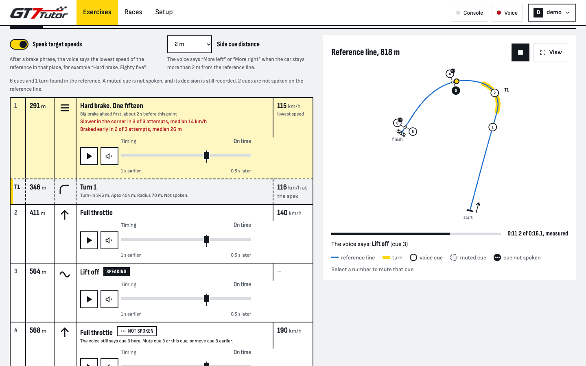

The preview stops by itself at the end of the reference. It also stops when you change a setting of this tab, and when you leave the tab. The preview does not start a training, and it does not record an attempt. **Preview** is only on the **Cues** tab. On a phone, **Preview**, **Stop** and **View** are icon buttons.

Changes apply from the next **Drive**. A training that already runs keeps the old settings.

## Drive an attempt

**Goal:** drive the exercise with the cues on the screen and, if you want, on the voice device.
**Before you start:** the exercise has an active reference, and the console sends telemetry.

### Start

1. Open the **Attempts** tab of the exercise, the review of an attempt, or the **Continue** card on the Exercises page.
2. Select **Drive**. On the **Attempts** tab and on the review, it is the yellow button with the word **Drive**. On the **Continue** card, it is the main button **Drive**.

**Result:** the dark Drive screen opens at once and shows `READY` in grey. There is no other page before it.

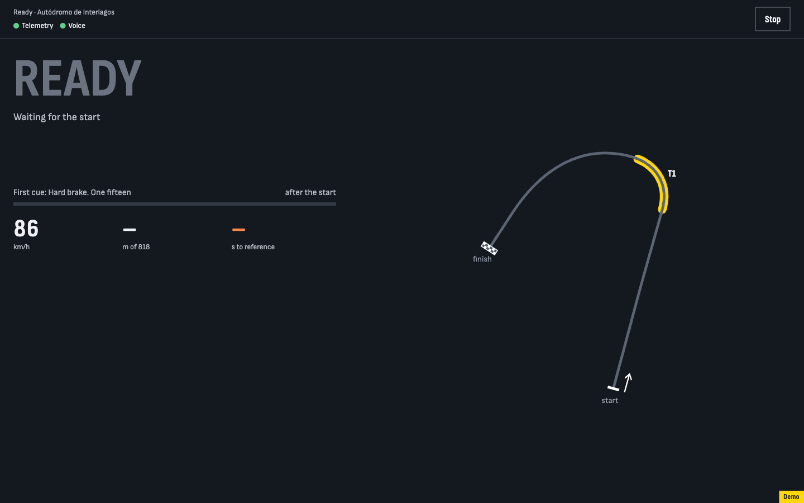

The READY screen shows:

- `Open the exercise in GT7 and drive.`
- `GT7 Tutor finds the start and the finish. You can look at the TV now. First cue after the start: <phrase>.`
- `No device plays the voice.` with the button **Use this device for voice**, when no device plays the voice. Select the button when this device must speak. The line also shows when this device has the voice but the sound did not start. If another device plays the voice, the line does not show.
- The map of the reference line at the right.

1. In GT7, start the exercise and drive. You do not need to touch GT7 Tutor.

GT7 Tutor finds the start and the finish of the attempt by itself. The time of the attempt is the time from the game.

An attempt can start without a voice device. If GT7 Tutor cannot load the voice clips, the Drive screen shows a message.

Other states of the **Drive** button:

- Without an active reference, the **Attempts** tab shows `Record the reference first.` with the link **Record** in place of **Drive**. The **Continue** card shows **Record the reference**.
- When the training of another exercise is on, a dialog asks `The training of <exercise> is on. Stop it and start this exercise?`. Select **Stop and start** to stop that training and start this exercise. Select **Cancel** to keep that training.
- While an attempt of another exercise runs, the text `Attempt <n> runs. Finish it or stop the training first.` shows under the button. Nothing starts.
- When the training of this exercise is on, **Drive** opens its Drive screen.
- If the start fails, the error shows under the button.

### During the attempt

| Part | Meaning |
| --- | --- |
| **Telemetry**, **Voice** | The status dots in the top row. Green means ready. The line under them gives the exercise name, which stays on one line and ends with `…` when it is long, and `Attempt <n>` at the right end. |
| Large yellow words | The current cue, for example `HARD BRAKE 115` or `FULL THROTTLE 140`. The number has the size of the words. It shows for about 3 s. The cue area has one height for all cues, so the lines below it do not move. |
| `Next: …, in … m` | The next cue and the distance to it |
| `Cue 2 of 6 · before T1` | The number of the current cue and the next turn |
| km/h | Your speed |
| `m of 818` | Your distance on the reference |
| `s to reference` | Your time at this place minus the time of the reference at the same place. A positive value means that you are slower. |
| Map | Your position on the reference line. Each turn is a yellow band from the turn-in to the end of the turn, with its label, for example `T1`. A short bar and an arrow mark the start and the direction of travel. A chequered bar marks the finish. |

The lines `Next` and `Cue … of …` keep their place while the attempt runs, also when they are empty.

The voice speaks about half a second before the place where the reference does the action. Other cues:

- `Hard brake`, `Brake` or `Light brake`: the reference loses at least 40 %, at least 15 % or less than 15 % of its speed.
- `Lift off`: the reference takes the foot off the throttle and does not brake.
- `Throttle on` or `Full throttle`: the reference opens the throttle. The cue is `Full throttle` when the reference reaches full throttle within 2 s.
- `Big brake ahead` before a long, hard brake.
- `Closer to apex` when you run wide before an apex.
- `More left` or `More right`, if **Side cue distance** is on.
- `Guidance paused` and `Guidance resumed` when GT7 Tutor cannot follow your position.

When you pause the game, the screen shows `Paused. Cues stop until you continue.` The attempt continues after the pause.

### After the finish

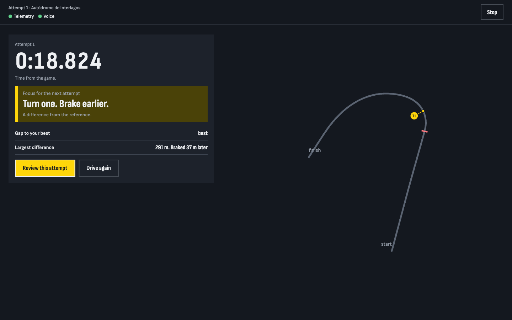

The summary shows:

- The time from the game.
- **Focus for the next attempt**: the place in one turn where you lose the most time, and its cause. An example is `Turn one. Too slow on entry.` The voice device also says it. GT7 Tutor uses your last 5 complete attempts with the same reference:
  - The turn is the turn with the largest median time lost. It must lose 0.1 s or more.
  - The turn has three parts: before the turn, the entry and the exit. Before the turn ends at the turn-in of the reference. The entry goes from the turn-in to the apex. The exit goes from the apex to the next turn. The part is the first part that loses more than 0.1 s and more than a fifth of the time lost in the turn. When no part does, it is the part that loses the most time.
  - The cause is a difference of that part in half or more of these attempts. Before the turn: `Braking too early before the turn.` or `Braking too late before the turn.` On entry: `Too slow on entry.`, `Too fast on entry.` or `Far from the apex on entry.` On exit: `Late on the throttle on exit.` A late brake is the cause in each part, and the sentence is then `Braking too late before the turn.`
  - `Off the line on entry.` and the other sentences with `Off the line` come only when no difference of the part is in half or more of these attempts. You must also be off the line in that part, in half or more of these attempts.
  - When no cause comes in half or more of these attempts, the sentence names the part only, for example `Turn two. Time lost on exit.`
  - When no turn loses 0.1 s or more, there is no focus. The screen and the voice then give no focus. An exercise without turns, for example a licence test on a straight, has no focus. Above turn 10, the screen shows the sentence, for example `Turn 11. Time lost on exit.`, and the voice does not say it.
- **Gap to your best**, and **Largest difference**.

Then:

- **Review this attempt** opens the review.
- **Drive again** closes the summary. The training stays on. Restart the exercise in GT7 to drive the next attempt.
- **Stop training** at the top right ends the training.

An attempt that does not finish shows `No time` and the reason, for example `left the track`, `restarted` or `training stopped`. Only a complete attempt has a time.

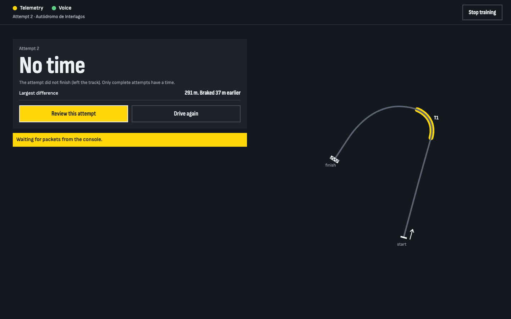

### Drive with or without the voice

You decide which help you use:

- **With the voice:** you chose a voice device. The voice says the cues.
- **Without the voice:** select **Turn voice off here** in **Setup** → **Voice**, or do not choose a voice device. The READY screen shows `No device plays the voice.` The attempt starts, and the screen shows the cues.
- **Without some cues:** mute them in the **Cues** tab.

GT7 Tutor compares every attempt with the reference from the game demonstration. It does not compare attempts with the voice against attempts without the voice.

### Stop

Select **Stop training** at the top right. If an attempt runs, GT7 Tutor stops it with the reason `training stopped`, and the attempt has no time. GT7 Tutor then opens the **Attempts** tab of the exercise.

### The training bar on the other screens

While the training is on, every screen except the Drive screen of that exercise shows a yellow bar under the top bar:

- `The training is on: <exercise>. Restart the exercise in GT7 to drive the next attempt.`
- While an attempt runs: `Attempt <n> runs: <exercise>. Stop training ends it without a time.`

On a phone, the bar shows only the first sentence.

- **Open Drive** opens the Drive screen of the exercise that trains.
- **Stop training** ends the training. If an attempt runs, the attempt has no time.

The training stays on when you open another screen. Stop it when you do not drive.

### Possible problems

- `The attempt did not start` with `The exercise was already running when you selected Drive. Restart the exercise in the game.`: restart the exercise in GT7. Select **OK** to close the message.
- `No packets from the console. Check that GT7 is running and that the address in Setup is right.`: see [No packets from the console](#no-packets-from-the-console).
- `Connection to GT7 Tutor lost.`: the browser lost the server. Check that GT7 Tutor runs and that the device is on the home network.
- `This exercise has no reference yet. Record it first.`: select **Record the reference**.
- `The recording is incomplete`: GT7 Tutor could not write the whole capture to the disk. The cues continue. Check the free disk space.

## Review an attempt

**Goal:** see where and how your attempt is different from the reference.
**Where:** **Review this attempt** after the finish, or a row in the **Attempts** tab.

The review shows the header and the tabs of the exercise. Under them:

- The attempt number and the time, for example `Attempt 2 · 0:18.824`. Under it, the gap to your best attempt and the gap to the reference, for example `+1.75 s to your best · +2.74 s to the reference`. The best attempt shows only the gap to the reference. Select the **Attempts** tab to go back to all attempts.
- The yellow **Drive** button starts the next attempt. On a computer, it is at the top of the right column. On a phone, it is under the attempt title, above **Your line**.

| Part | What it shows |
| --- | --- |
| **Your line** | The map with the reference line (blue) and your line (orange). A circle marks a difference. The legend has the words `reference line`, `you`, `turn` and `A gap in your line is a place without a match`. A gap is a place where GT7 Tutor could not match your position. |
| **True scale** / **Side distance × 6** | **Side distance × 6** draws your line 6 times farther from the reference line, so that a difference of 1 m shows. A dot marks the largest side distance in each turn. Put the pointer on a dot, move the focus to it with the Tab key, or touch it. A tip then shows the true distance and the place, for example `T1 · 3.5 m left` and `at 120 m`. When a dot has the focus, press Esc to close the tip. On a touch screen, touch the map away from the dots to close the tip. The legend then also has `more than <n> m from the line` for the parts beyond the **Side cue distance**. On a phone, the two buttons are in a row under the title. |
| **View** | Opens the map in full screen, with your line in true scale and the list of the differences. Select a difference in the list to find it on your line. Press Esc or select **Back** to close. |
| **Differences by turn** | The differences, grouped by turn, with the time lost or gained in each turn. The time of a turn starts at its first brake or lift-off. It stops at the first brake or lift-off of the next turn. The first turn starts at the start of the section or the lap. The last turn stops at its end. The times of all turns add up to the change of the chart **Time lost** from its start to its end. The column headers **Turn** and **Time lost** set the order. **Turn** puts the turns in the order of the track. **Time lost** puts the turn with the largest time lost first. Select the active header again to reverse the order. An arrow shows the active order and its direction. Select a difference to put the cursor there. A section without turns shows one group, **Whole section**. `No differences above the limits in this attempt.` means that GT7 Tutor found no difference. |
| **Corners** | Your line at each apex: on the line, or the distance inside or outside, and your speed at the apex. A section without turns has no **Corners**. |
| **Brake reaction** | The time from the start of a spoken brake cue to your brake. A value `before the cue` means that you braked before the voice. |
| Charts | Speed, throttle, brake, the distance from the reference line, and the time lost. On **Speed**, a ring marks the lowest speed of each line in each turn with a brake zone. Your ring shows only when your lowest speed is inside the turn and has no gap before or after it. The legend calls it `lowest speed in the turn`. When the chart has 3 turns or fewer with rings, each ring also shows its speed, for example `116 km/h`. Move the pointer across a chart. On a phone, tap a chart or drag a finger sideways. A vertical swipe scrolls the page. With a keyboard, move the focus to a chart and use the arrow keys. A dashed line and a dot on each line mark the cursor on all charts. The map shows the same place. On the chart under the pointer, the finger or the focus, a box gives the distance, the turn and the values, for example `Reference: 110 km/h` and `You: 108 km/h`. **Time lost** has no box. It gives its value at the top right. |
| **Compare with** | Another reference of the exercise. The review then compares the same attempt with that reference. Each choice gives the name of the reference and its day. The active reference has `active` in place of the day. `used` marks the reference that you drove this attempt against, for example `Demonstration · active · used`. |

After an update of GT7 Tutor with new rules for the differences or the turns, GT7 Tutor calculates the differences of your earlier attempts again. The first view of an exercise after the update can then take some seconds.

Read a difference with care. `Braked 37 m later` compares your brake that is nearest to the brake of the reference, within 60 m. If you pressed the brake two times, the charts show both.

`Lowest speed 53 m before the apex` tells you that your lowest speed in the turn is more than 20 m before the lowest speed of the reference. `after the apex` tells you that it is more than 20 m after it. The distance is from the apex of the reference. GT7 Tutor gives this difference only for a turn with a brake zone. The lowest speed of the reference must also be 6 m or less from its apex. When this difference is in the focus, the sentence is `Too slow on entry.` for a lowest speed before the apex, or `Too fast on entry.` for a lowest speed after it.

Other actions under **Source**:

- **Use this attempt as a reference** (complete attempts only): the attempt becomes the active reference. The demonstration stays in the reference history.
- **Delete attempt**: opens a dialog that shows what goes. **Delete attempt** in the dialog deletes the attempt with its cues and differences. **Keep it** closes the dialog. See [Delete data](#delete-data).

## See all attempts and recurring differences

**Where:** the **Attempts** tab of the exercise.

- The yellow **Drive** button starts an attempt. See [Drive an attempt](#drive-an-attempt). On a computer, it is at the top of the right column. On a phone, it is under the tabs, with **Select** and **Hide aborted** under it.
- `Your focus` above **Drive** gives the focus sentence of your last complete attempt. GT7 Tutor uses only attempts with the active reference. An aborted attempt does not count. An example is `Turn one. Braking too early before the turn.` It is the same sentence as on the summary after the attempt. Without such an attempt, or when that attempt has no focus sentence, the line does not show.
- Without attempts, the tab says `No attempts yet. Select Drive, then drive the exercise in the game.`
- GT7 Tutor groups the attempts by day. The heading of each day is the date.
- **Time**: the time of a complete attempt from the game. `No time` and `aborted` with the reason for an attempt that did not finish. The best attempt has the tag `best`.
- **Gap to best**: the gap of the attempt to your best time. On a phone, it is next to the time.
- The review of an attempt shows its differences. See [Review an attempt](#review-an-attempt).
- Select a row to open the review of the attempt.
- On a computer, **Select** and **Hide aborted** are at the right end of the first day heading.
- **Hide aborted** hides the attempts that did not finish. The button then says **Show aborted** and is filled. Select **Show aborted** to show the attempts again.
- **Select** lets you mark attempts and delete them. In this mode, a click on a row marks the attempt and does not open the review. The quick buttons of each day mark the aborted attempts or all attempts of the day. A quick button without attempts does not show. The bar at the bottom shows the number of marked attempts, **Cancel** and **Delete N attempts**. On a phone, the bar is one line, and the delete button says only **Delete**. See [Delete data](#delete-data).

**Recurring differences** lists the differences at the same place in at least half of your last complete attempts. GT7 Tutor uses the last 8 complete attempts and compares them with the active reference. You need at least three complete attempts. `No difference repeats in your last attempts.` means that no difference reaches half of them.

## Track your progress

The **Exercises** page shows:

- **Continue**: the current exercise, `your best time` and the gap to the target, for example `0.67 s` with `to the target, 0:16.400`. On a phone, one line gives `best 0:17.071 · 0.67 s to the target`. The gap shows only when the exercise has a best time and a target, and the best time is more than the target. The main button is **Drive** when the exercise has an active reference. Then, on a computer, **Attempts** opens the **Attempts** tab. Without an active reference, the card shows only **Record the reference**. Under the times, `Your focus` gives the focus sentence of your last attempt, as on the **Attempts** tab. Select the exercise title to open the exercise. Above the title, a line gives `Continue`, the family, the name and the track, for example `Continue · Licence · Cornering Basics 3 · Tsukuba Circuit`. On a phone, it gives only `Continue`.
- **In progress**: your exercises that are not at the target, in the order of the catalogue, and your own exercises last. Each row gives the title, the best time and the gap to the target, for example `0.07 s to the target`. On a phone, the gap is short, for example `0.07 s`. A row without a best time gives the target. On a computer, the row also shows the track and the car. An exercise at the target is not in this list: its catalogue row has the tag `Target reached`.
- **Catalogue**: all entries in groups, with the numbers at the target and in progress. See [Choose an exercise](#choose-an-exercise).

A new profile has no **Continue** card and no **In progress** list. The page then shows a short text under the title and the closed catalogue groups.

The tag `Target reached` shows when your best time is equal to the target or less.

### Set the target

**Goal:** set the time that you want to reach in an exercise.

1. Open the exercise. The band under the exercise name shows `target` with **edit**.
2. Select **edit**. The target becomes a text field in the same place.
3. Type the time, for example `23.8`, `0:23.800` or `1:02.345`. A comma is also correct, for example `23,8`. On a phone keypad without `:`, type the seconds only, for example `62.345`.
4. Push **Enter**, or select another place on the page.

**Result:** the band shows the new target and the `gap to the target`. The status tag and the **Continue** card use the new target.

- **Esc** closes the field and keeps the old target.
- An empty field deletes the target. The band then shows `–`.
- A text that is not a time keeps the old target.

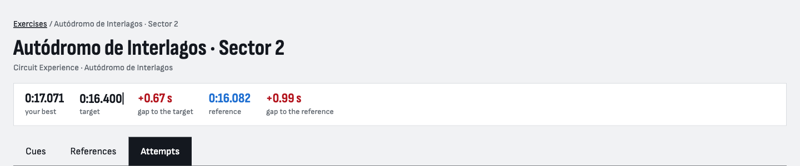

## Record a race and look at it

GT7 Tutor can record a race by laps in the game. After the race, you look at your laps, compare two laps, and find the places where you went off the track. A race does not need a reference, and it gives no voice cues.

### Record a race

**Goal:** record a race of the game lap by lap.
**Before you start:** you saved the console address, GT7 runs, and no recording or training runs.

1. Select **Races** in the menu.
2. Select **Record a race** (on a phone: **Record**).
3. In GT7, start a race of 2 or more laps.

**Result:** the dark recording screen opens. It starts and stops with the race. You do not need to touch GT7 Tutor during the race.

The recording screen has these states:

| State | Large word | What the screen shows |
| --- | --- | --- |
| Waiting | `WAITING` in grey | `Start a race of 2 or more laps in the game.` and `The recording starts with the race and stops at the finish. You can look at the TV now.` |
| On the grid | `LAP 1 of <n>` | `this lap`, your position, `last lap` and `best lap` as `–`, and the fuel |
| A lap runs | `LAP <n> of <n>` in yellow | `this lap` (the live lap time), the position, for example `P 8` `of 20`, `last lap`, `best lap · lap <n>`, and the fuel with `about <n> laps left` and a bar |
| Finished | `FINISHED` and your finish position, for example `P 6 of 20` | `You started in position <n>. The race is in your list.`, the `race time` and the `best lap` |
| Stopped | `RECORDING STOPPED` | The number of laps in your list, the time of the recorded laps, the best lap and the position |

Other parts of the recording screen:

- The dot at the top left: `Recording` with a red dot while GT7 Tutor records the race. `Recording · no telemetry` with a yellow dot when no packets come. `Telemetry` with a green dot, or `No telemetry` with a grey dot, while the screen waits and after the end.
- The line under the dot: the car, or `Race recording` while the screen waits.
- The lap circles: one circle for each lap of the race. A small key under them gives the meaning of the signs that show, from `lap not recorded`, `lap done`, `this lap`, `lap to come`, `best lap` and `pit stop after this lap`.
- The map: the line of the track that you drove, with a trail that fades behind the car.
- The button at the top right: **Cancel** while the screen waits, **Stop recording** during the race, **Close** after the end.

The recording continues when you pause the game and during a pit stop.

**How the recording ends:**

- At the finish. The screen shows `FINISHED`, then opens the race by itself after a moment. Select **Open the race** to open it at once.
- When you leave the race in the game, for example to the menu, or when you restart the race. GT7 Tutor keeps the complete laps.
- When no packets come for 10 s during the race.
- When you select **Stop recording**. GT7 Tutor keeps the complete laps.
- When GT7 Tutor stops on the computer. GT7 Tutor keeps the complete laps.

GT7 Tutor stores a race that ends before the finish as not finished, for example `3 of 5 laps, not finished`. It does not store a lap that did not end. If no lap is complete, the screen says `No complete lap was recorded. Nothing was saved.` Select **Back to Races**.

**A recording that starts during a race.** You can select **Record a race** while a race runs. The screen then shows `The race runs already` and `The recording starts at the next lap line.` GT7 Tutor does not record the lap that runs and the laps before it. The laps keep the numbers of the game. GT7 Tutor stores the race as not finished, for example `laps 5 to 7 of 7, not finished`. Its start position is the position at the first recorded lap line.

**Only a race by laps.** GT7 Tutor records only a race of 2 or more laps. In another session, for example a time trial or a race by time, the screen says `This is not a race of 2 or more laps. Only a race by laps can be recorded.` The recording waits for a race by laps.

**The bar on the other screens.** While a race recording runs, the other screens show a yellow bar under the top bar:

- `Waiting for the race. Start a race by laps in the game.`
- `Recording a race · lap <n> of <n>`
- `Recording a race · it starts at the next lap line`

Select **Open the recording** to go back to the recording screen, or **Stop recording** to stop it.

A recording of a race needs the training off. If a recording or a training runs, **Record a race** shows `A recording or a training runs. Stop it first.`

### Name the track

The game does not send the name of the track. When only one circuit of the catalogue has a length near the length of your lap, GT7 Tutor gives the race that name. Else the list shows `Race without a track name`.

1. Open the race.
2. Under the track name, select **Name the track** (or **Change the name**).
3. Select one of the tracks in the list, or select **Another name** and type the name.
4. Select **Save the name**.

The list gives up to 5 circuits of the catalogue with a length near the length of your lap. The nearest length is first. Select **Cancel** to close the dialog without a change.

### Laps

**Where:** select a race in **Races**. The race opens on the **Laps** tab.

The header of the race shows the date and the time of the start and the lap length, for example `lap length 6,181 m`.

**The band** at the top shows:

- The car, the laps, the number of cars and the pit stops, for example `7 laps · 20 cars · 2 pit stops`.
- `race time`: the sum of the lap times of the game. For a race that is not finished: `time of the recorded laps`.
- `best lap · lap <n>`, in yellow.
- The position from the start to the finish, for example `20 → 2` with `position, start to finish`.

**The lap table** has one row for each recorded lap:

| Column | Content |
| --- | --- |
| **Lap** | The number of the lap in the game |
| **Time** | The lap time of the game. The best lap has the tag `best`. The in-lap has the note `into the pit lane`, and the out-lap has the note `out of the pit lane`. |
| **Gap to best** | The lap time minus the time of the best lap, for example `+1.142 s` |
| **Position** | The position at the start and at the end of the lap, for example `11 → 6` |
| **Top speed** | The highest speed of the lap |
| **Off the track** | The number of moments with all 4 wheels off the track (a red dot), and with 2 or 3 wheels off (a red ring). `none` when the lap has no moment. |

A pit stop row comes between the in-lap and the out-lap, for example `PIT STOP 35.48 s in the pit lane Fuel 38 → 100`. The time is the time from the stop to the pit exit.

Select a lap row to compare that lap with the reference lap. See [Compare two laps](#compare-two-laps).

The **reference lap** of a race is its fastest lap that is not lap 1 and has no pit stop. Lap 1 starts on the grid, not at the lap line. Without such a lap, for example in a race of 2 laps, it is the fastest lap of the race. Usually the reference lap is the best lap. When it is another lap, the hint under the table names it, for example `Select a lap to compare it with lap 4, the best lap without a pit stop.`

**Position** shows your position, lap by lap, over the race time. Grey bands mark the pit stops. The labels `P1` and `P2` under the chart name the pit stops. Move the pointer across the chart. On a phone, tap the chart or drag a finger sideways. A vertical swipe scrolls the page. A box and the line over the chart give the lap, the distance from the lap line and the position at that time, for example `Cursor at lap 3, 1,200 m: position 8, up from 9.`

**Fuel** shows the fuel, lap by lap. It shows only when the fuel changes during the race.

**Speed** shows the speed of each lap over the distance from the lap line. Each lap has its own colour. After 10 laps, the colours start again. The line of the best lap is thicker. The turns are yellow bands.

Move the pointer across the chart, or move the focus to it. On a phone, tap the chart or drag a finger sideways. A vertical swipe scrolls the page. A dashed line and a dot on each line mark the cursor. A box at the cursor gives the distance, the turn and the speed of each lap that shows, for example `Lap 4: 157 km/h`.

The legend under the chart has a button for each lap, for example **Lap 4**. Select a button to hide the line of that lap. Select it again to show the line. A hidden lap has a grey name. You can hide all laps. When you open the **Laps** tab again, all laps show.

Select **View** at the top right of the chart to open the chart in full screen. The full-screen chart is dark and uses all the height of the screen. Under the title, a line gives the track and the number of laps, for example `Mount Panorama Motor Racing Circuit, 7 laps`. The full-screen chart has the same legend. A lap that you hide there stays hidden on the tab. Press Esc or select **Back** to close the full-screen chart. On a phone in landscape, the title and the track share one line, and the legend is one row under the chart. Swipe the row sideways when it is wider than the screen.

### Compare two laps

**Where:** the **Compare** tab of the race, or a row of the lap table.

The heading gives the gap of the two lap times of the game, for example `Lap 7 is 2.020 s slower than lap 4`. Use the two selects to choose the lap and the lap to compare it with. By default, the tab compares the last lap that is not the reference lap with the reference lap.

The tab shows the same parts as the review of an attempt. These parts are the map with the two lines, **Differences by turn**, and the charts of speed, throttle, brake and time lost. Here the other lap takes the place of the reference. It is one of your laps, not the best possible line. The legends name the two laps, for example `lap 4` and `lap 7`. The rings on **Speed** mark the lowest speed of each lap in each turn with a brake zone. The box of the chart under the cursor gives the value of each lap, for example `Lap 4: 155 km/h` on **Speed** and `Lap 4: 100%` on **Throttle**. **Time lost** has no box. It gives its value at the top right. On a computer, **Differences by turn** stays beside the map and the charts. Scroll the list of the turns inside its column. When you select a difference on the map, the list moves to that difference. See [Review an attempt](#review-an-attempt).

With an in-lap or an out-lap:

- A gap in the line is the pit lane.
- The curve of an out-lap starts at the pit exit. A note under the chart tells you that the rest of the gap is in the pit lane.

`These two laps do not match. Choose another lap.`: GT7 Tutor could not put one lap on the line of the other. Choose another lap.

### Off the track

**Where:** the **Off the track** tab of the race.

- **Places**: the map of the line of the reference lap. A red dot marks a moment with all 4 wheels off. A red ring marks a moment with 2 or 3 wheels off. A black circle with a letter marks a recurring place. Select a mark to put the cursor there. **View** opens the map in full screen with the list of the moments.
- **Recurring places**: the places where you went off the track in 3 or more laps. An example row is `3,190 m. All 4 wheels off in 1 lap.` with the letter `A`. The row also gives the speed of the reference lap at that place and the largest speed loss. At the right, it gives the number of laps, for example `6 of 7`. Under the list: the number of other places, each in 1 or 2 laps.
- **Off the track** (chart): one row for each lap, with a mark for each moment over the distance from the lap line. A black bar marks the pit lane. Select a mark to see the lap, the wheels and the speeds.
- **Height of the track**: the height above the lowest place of the lap.
- **Speed of the best lap** (or **Speed of lap <n>**): the speed of the reference lap at each place.

The three charts and the map use the same cursor. With a keyboard, move the focus to a chart and use the arrow keys. In the lap rows of the chart **Off the track**, the arrow keys move from moment to moment. The recurring places are yellow bands on the charts.

A race without a moment shows `No moments off the track in this race.`

### Golden lap

**Where:** the **Golden lap** tab of the race.

The golden lap is the fastest lap that you can drive from parts of your clean laps of this race. GT7 Tutor cuts each clean lap into parts, one part for each turn. Then it joins the fastest parts that fit together.

- **Clean laps**: lap 1 and the laps with a pit stop do not count. When the recording starts after lap 1, the first recorded lap does not count. A lap without a time for each part of the lap does not count. A lap that leaves the track in a part gives no time for that part.
- **Joins**: at the join, two parts of different laps fit together when the speed differs by 5 km/h at most. The line must also differ by 1.5 m at most. Two parts of the same lap always fit. The end of the last part must also fit the start of the first part.

The dark band gives the best clean lap, the golden lap in yellow and the possible gain, for example `1:14.120`, `1:13.325` and `−0.795 s`. The caption `best clean lap` tells you that this lap can be another lap than the best lap of the **Laps** tab. The caption of the golden lap names the laps that give its parts, for example `golden lap · from laps 3 and 4`. The text under the band gives the join limits.

**Turns** has one row for each turn:

| Column | Content |
| --- | --- |
| **Turn** | The turn, for example `T3` |
| **Part of the lap** | The distance of the part from the lap line, for example `1,369–1,956 m` |
| **Golden lap** | The time of the part in the golden lap and its lap, with the colour of that lap on the map |
| **Best** | The best time of the part in the clean laps and its lap |
| **Median** | The median time of the part in the clean laps |
| **Spread, best to median** | The median time minus the best time, with a bar. A large spread shows a turn where your laps are not the same. You can find time there. |

The table opens with the largest spread first. Select **Turn** to put the turns in the order of the track. Select **Spread, best to median** to put the largest spread first again. Select the active header again to reverse the order. An arrow shows the active order and its direction. With a keyboard, move the focus to a header and push Enter or Space.

A time in the **Golden lap** column can have a hint under it:

- `Best 3.340 (lap 2) does not fit`: the best time of this part does not fit the parts before or after it. The golden lap uses the part of another lap here.
- `Lap 2 off track here`: this lap left the track in this part. Its time does not count for this part.

**Where each part comes from** shows the line of the lap. Each part has the colour of its lap. The legend names the lap of each colour, for example `from lap 3`. A circle marks each join between two parts. Yellow labels name the turns. With more than 4 source laps, the colours show again as dashed lines.

On a phone, the caption of the golden lap is only `golden lap`. The text under the band names the laps of the parts. The table shows only **Turn**, **Golden lap** and **Spread**, and the map is under the table.

When the race has no golden lap, the tab shows `No golden lap for this race` and the reason:

- **Too few clean laps**: a golden lap needs 3 clean laps. The text names the clean laps and tells why each other lap does not count. The reasons are the first lap, the first recorded lap, a pit stop and a lap without a time for each part. An example: `Laps 2, 3, 5 and 6 have a pit stop and do not count.`
- **A turn without a clean lap**: `Each clean lap left the track in turn 5, so no clean lap gives a time for that turn.`
- **Parts that do not fit**: `Each clean lap left the track in one turn or more, and the other parts do not fit together at the joins.`

### Show the races of one track

When your races are on 2 or more tracks, the list has a **Track** field under **My races**. Each choice gives the track and the number of races on it. Choose a track to show only its races. Choose **All tracks** to show all of them. The text next to the field gives the number of races that show, for example `2 of 9 races`. **Select** works on the races that show. A new choice of track clears your marks.

### Delete a race

1. In **Races**, select **Select**.
2. Mark one or more races.
3. Select **Delete N races**.
4. Select **Delete race** (or **Delete races**) to delete, or **Keep race** (or **Keep races**) to close the dialog.

The laps, the pit stops and the places off the track of the race go. You cannot undo it. The raw capture stays until a clean-up: **Clean up captures** in **Setup** → **Data** frees the disk space.

## Manage references

**Where:** the **References** tab of the exercise.

A reference is never overwritten. Each new reference joins the history. One reference is active. Each attempt remembers the reference that it was driven against.

- **Record a new reference** opens the recording screen.
- **Make active** (an attempt) or **Return to the demonstration** makes another reference active.
- **Needs a check**: you changed the **GT7 version** in **Setup** → **Preferences**, and you recorded this reference with another version or with no version. Select **Check with one recording** and record the demonstration once. GT7 Tutor then says if the reference still matches the game.
- **Delete** shows only for a reference that is not active and that no attempt uses. It opens a dialog. Select **Delete reference** to delete the reference, or **Keep it** to close the dialog.

## Profiles: sign in, sign out, switch, change and delete

**Where:** **Setup** → **Profiles**, or **Manage profiles** in the profile menu.

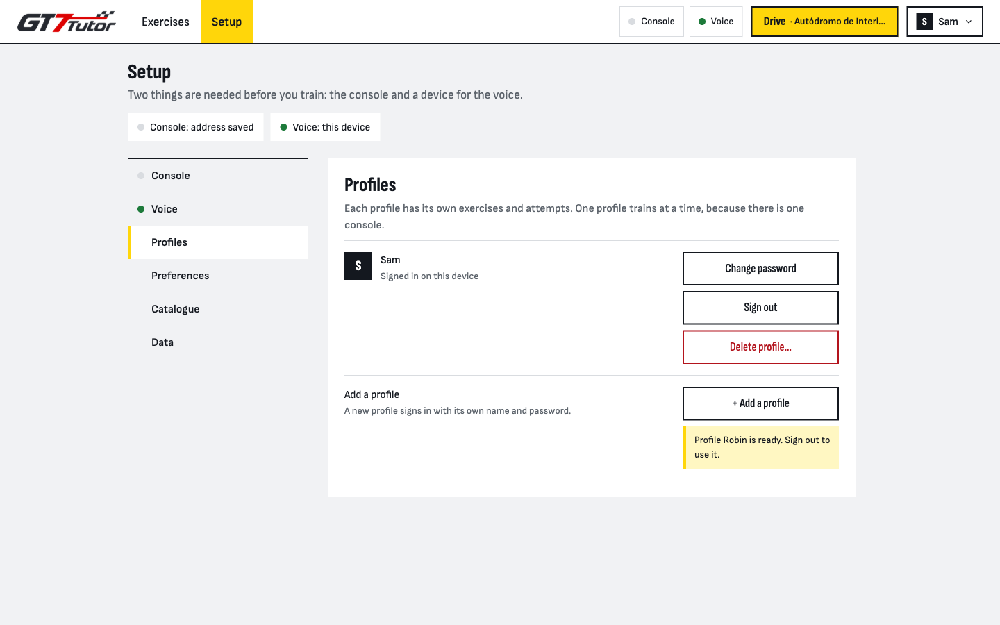

Each profile has its own exercises, references, attempts and voice device. One profile trains at a time, because there is one console. The console address is for the whole computer.

### Add a profile

1. Select **+ Add a profile**.
2. Type a **Name** and a **Password** of at least 8 characters.
3. Select **Add profile**.

**Result:** `Profile <name> is ready. Sign out to use it.`

### Sign out and switch profiles

1. Select **Sign out** (in the profile menu or in **Profiles**).
2. On **Who is driving?**, select the profile.
3. Type its password and select **Sign in**.

Everyone on your home network can see the profile names. After too many wrong passwords for one name, GT7 Tutor shows `Too many failed sign-ins for this name.` Wait 15 minutes, then try again.

### Change the password

1. Select **Change password**.
2. Type the **Current password** and the **New password** (at least 8 characters).
3. Select **Save**.

GT7 Tutor signs out the other devices that use this profile. This device stays signed in.

### Delete a profile

See [Delete data](#delete-data).

## Other settings

### Console

**Setup** → **Console** shows the **PS5 address** and the **Telemetry** state as text. A red text marks a problem: `GT7 Tutor does not answer. Check that it runs on the computer.` or `No packets. Check the console address.` **Save and check** saves the address and checks the reception. **Check again** listens for packets again and shows the number of packets and the car.

The computer must accept UDP on port 33740. If the check finds no packets, allow the port in the firewall.

The PS5 address can change after a router restart. Then type the new address and select **Save and check**.

### Voice

The **Voice device** line shows one of these texts:

- `This device plays the voice.`
- `Another device plays the voice. This device stays silent.`
- `No device plays the voice.`
- `The browser did not start the sound on this device. Select Use this device for voice again.` The text is red.

- **Use this device for voice** moves the voice to this device. The other device stops to play cues.
- The speaker button (**Test**) plays `Voice check`. The message gives the output delay that the browser reports. This is not a measurement.
- **Turn voice off here** stops the voice on this device. The Drive screen still shows the cues.
- **Delay correction for wireless headphones**: −200 ms to +400 ms. It applies on this device. Wireless headphones add a delay that the browser does not know. A positive value starts the cues earlier. If the voice sounds late, increase the value.

### Preferences

- **Theme**: **System**, **Light** or **Dark**. The Drive screen is always dark.
- **Screen updates while driving**: 15, 30 or 60 per second. The default is 15. The setting applies to the browser where you change it, on a computer or on a phone. Each device keeps its own value. A higher value moves the speed, the distance, the gap and the map point more smoothly. It also uses more network, more battery on a phone or a laptop, and can make the page slower on an older phone. The voice cues arrive at once with every value.
- **GT7 version**: GT7 Tutor stores it with each new reference. When you change it, the references of another version get **Needs a check**.

### Catalogue

The catalogue is the list of exercises that you can add. **Catalogue version** is the date when the project read the public sources.

1. Select the refresh button (**Check for updates**). GT7 Tutor reads the public sources again over the internet. It sends no data about you or your driving.
2. Read the differences under the headings `Added`, `Changed` and `Removed`. Nothing changes yet.
3. Select **Apply update** to use the new catalogue.

An entry that has your exercises stays. After an update, **Restore** makes the previous catalogue active again.

## Delete data

**Before you delete:** you cannot undo any of these actions.

| Action | Where | What goes | What stays |
| --- | --- | --- | --- |
| Delete one attempt | Review → **Delete attempt** | The attempt, its cues and differences | References, other attempts. The raw capture stays until a clean-up. |
| Delete several attempts | Attempts → **Select** → **Delete N attempts** | The selected attempts, their cues and differences. GT7 Tutor counts your best time and the recurring differences again. | References. The raw captures stay until a clean-up. |
| Delete a reference | References → **Delete** → **Delete reference** | The reference | Only possible when the reference is not active and no attempt uses it |
| Delete an exercise | Exercises → **Select** → **Delete N exercises** | The exercise, its attempts, references, best time and target | The catalogue entry. You can record its reference again. |
| Delete races | Races → **Select** → **Delete N races** | The selected races with their laps, pit stops and places off the track | The exercises. The raw captures stay until a clean-up. |
| Clean up captures | Setup → Data → **Clean up captures** | The parts of the raw captures that no reference, no attempt and no race uses | All references, attempts and races |
| Delete history: **Attempts of one exercise** | Setup → Data → **Delete history** | The attempts of the selected exercise | Its references, the other exercises, the races, the settings |
| Delete history: **All attempts** | Same | All attempts of your profile | Exercises, references, races, settings |
| Delete history: **Start over** | Same | All attempts, references, races and exercise progress of your profile | The profile, the password, the voice and console settings, the catalogue |
| Delete a profile | Setup → Profiles → **Delete profile** | The exercises, references, attempts, races and captures of the profile, and its sign-in on every device | Other profiles and the settings of this computer |

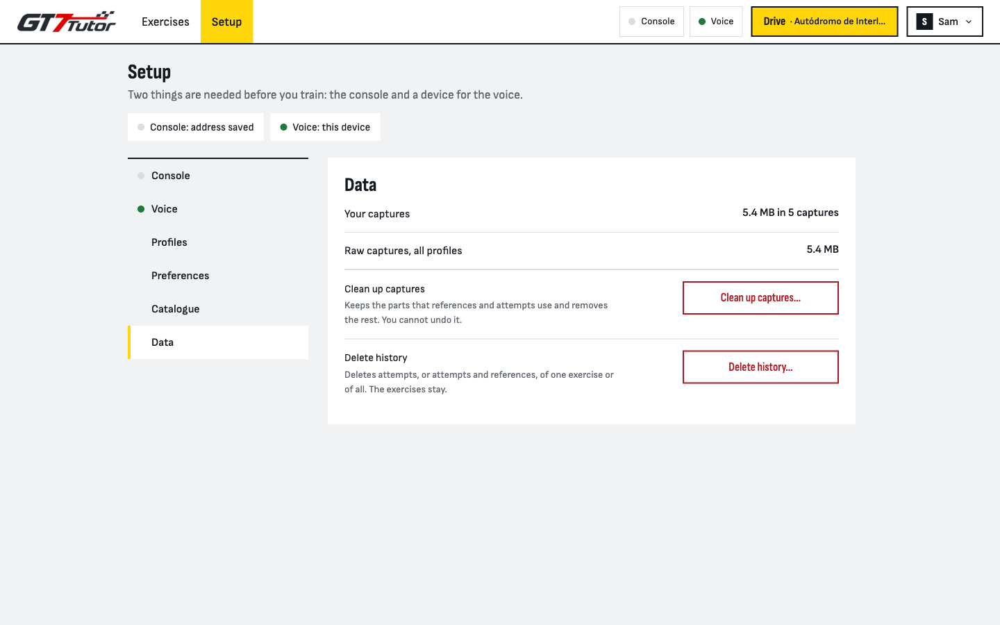

A race uses much disk space: its raw capture takes about 2.4 MB per minute of the race. A race of 7 laps can take about 45 MB. To free the space, delete the race, then select **Clean up captures**.

A delete needs the training off. When the training is on, a delete dialog and the **Delete history** page say `The training of <exercise> is on. It stops when you delete.` The delete button then says **Stop the training and delete**. One click stops the training, then deletes. If the training does not stop, GT7 Tutor shows the error and does not delete.
While an attempt runs, the dialog says `Attempt <n> runs. Finish it or stop the training first.`, and you cannot delete.

**Delete history:**

1. Select **Setup** → **Data** → **Delete history**.
2. Select what to delete. For **Attempts of one exercise**, select the **Exercise**.
3. Leave **Also clean up the raw captures that nothing uses afterwards** on to free disk space.
4. Read **This deletes** and **This keeps**.
5. Type your profile name. GT7 Tutor deletes only after this step.
6. Select the red button, for example **Delete all attempts**.

**Delete a profile:**

1. Select **Setup** → **Profiles** → **Delete profile**.
2. Read the list of what goes.
3. Type the password of the profile.
4. Select **Delete profile**.

**Result:** GT7 Tutor signs you out and shows **Who is driving?**.

## Use a phone

The phone and the computer must be on the same home network.

1. Scan the QR code that `./start.sh` shows, or type the address for the phone, for example `http://192.168.0.10:3000`.
2. Sign in with your profile.
3. Select **Use this device for voice** if the phone must speak.

On a phone, **Exercises**, **Races** and **Setup** are in the bottom bar. Setup shows all its sections on one page.
On a tablet in portrait, between 600 and 899 px wide, the page keeps the one-column layout. The column is about 640 px wide and stands in the middle of the screen.
On the **Laps** tab of a race, each lap row has two lines. The first line gives the time and the gap to the best lap. The second line gives the position, the top speed and the pit lane note.

| Exercises on a phone | Drive on a phone | A race on a phone |
| --- | --- | --- |
|  |  |  |

The recording screen on a phone fills the screen. Use **Start recording** and **Stop recording** at the bottom, and **Close** to go back.

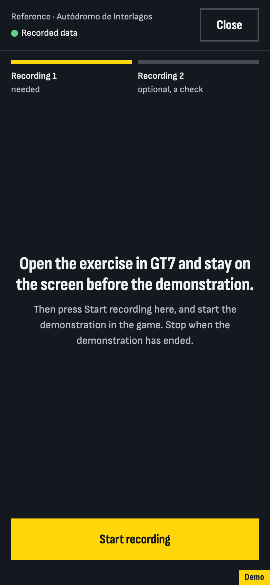

Two limits come from the phone browser:

- A browser does not let a page start sound by itself. Tap **Use this device for voice** after you open or reload the page.
- A locked screen stops the sound. Turn off auto-lock during a session.

## Try the demo

The demo shows GT7 Tutor with recorded data. You need no PS5. To start it, see the [README](../../README.md#try-the-demo-without-a-console).

1. Open the address that the start script shows. A yellow label `Demo: recorded data, no console` is at the top of each screen.
2. On **Who is driving?**, the demo fills in the profile `demo` and its password. Select **Sign in**.
3. Select **Use this device for voice** in **Setup** → **Voice**.
4. Open the exercise, then the **Attempts** tab.
5. Select **Drive**. The Drive screen opens, and a recorded attempt plays in real time, with the cues on the screen and on the voice device.
6. After the summary, select **Review this attempt**.

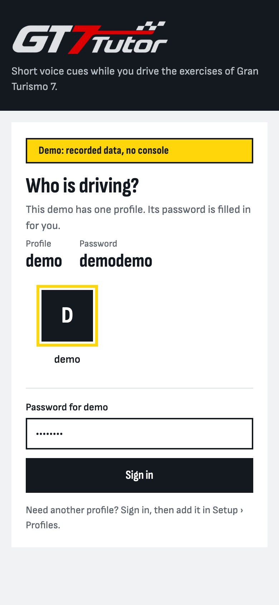

The demo has its own database. It does not change your profiles.
In the demo, you cannot change the console address, the password or the catalogue, and you cannot delete the profile.
The demo has no race. To see the race screens, record a race with your PS5.

## Common problems

### No packets from the console

You see `No packets`, `Address saved, no telemetry yet` or `No packets from the console`.

1. Check that the PS5 is on and that GT7 runs past the title screen.
2. On the PS5, read the IPv4 address again. Compare it with **Setup** → **Console**.
3. Check that the computer accepts UDP on port 33740. On macOS, allow incoming connections for Node.js when the system asks. On Linux with `ufw`, run `sudo ufw allow 33740/udp`.
4. Select **Check again**.

### No sound

1. Look at the **Voice** dot in the top bar. Yellow means `The sound did not start on this device`. Red means `No device plays the voice`.
2. Select **Use this device for voice** again, then the speaker button.
3. Turn off the silent mode of the phone, and turn up the volume.
4. On an iPhone after a screen lock, reload the page, then select **Use this device for voice** again. See the [README](../../README.md#use-a-phone).

### The voice comes too late

1. With wireless headphones, increase **Delay correction for wireless headphones** in **Setup** → **Voice**.
2. For one cue, move **Timing** earlier in the **Cues** tab.
3. Check **Brake reaction** in the review. It shows how long after the cue you start to brake.

### The attempt does not start

- The exercise was already running when you selected **Drive**. Restart the exercise in GT7.
- The game does not time this exercise from the start. GT7 Tutor cannot follow this exercise.

### No reference can be found

The game does not time the demonstration of this exercise, or the recording stopped before its end. Record again and let the demonstration play to the end. If it fails again, GT7 Tutor cannot follow this exercise.

### The page says the server did not answer

GT7 Tutor does not run on the computer. Start it with `./start.sh`, then reload the page.

### The race recording waits and does not start

The recording screen shows `WAITING`.

1. Check the **Console** dot. Without telemetry, see [No packets from the console](#no-packets-from-the-console).
2. Start a race by laps in GT7. The recording starts on the grid, or at the next lap line when the race already runs.

### This is not a race of 2 or more laps

The session in GT7 is not a race by laps, for example a time trial, a race of 1 lap or a race by time. GT7 Tutor records only a race of 2 or more laps. Start such a race, or select **Cancel**.

### The recording of this race is no longer on the disk

`The recording of this race is no longer on the disk. The lap table stays.`: the raw capture of the race is missing, for example after you deleted files in the data folder. The lap table and the band stay. **Compare**, **Speed** and the map of **Off the track** need the raw capture. Without it, **Off the track** shows the moments as a list by lap.
